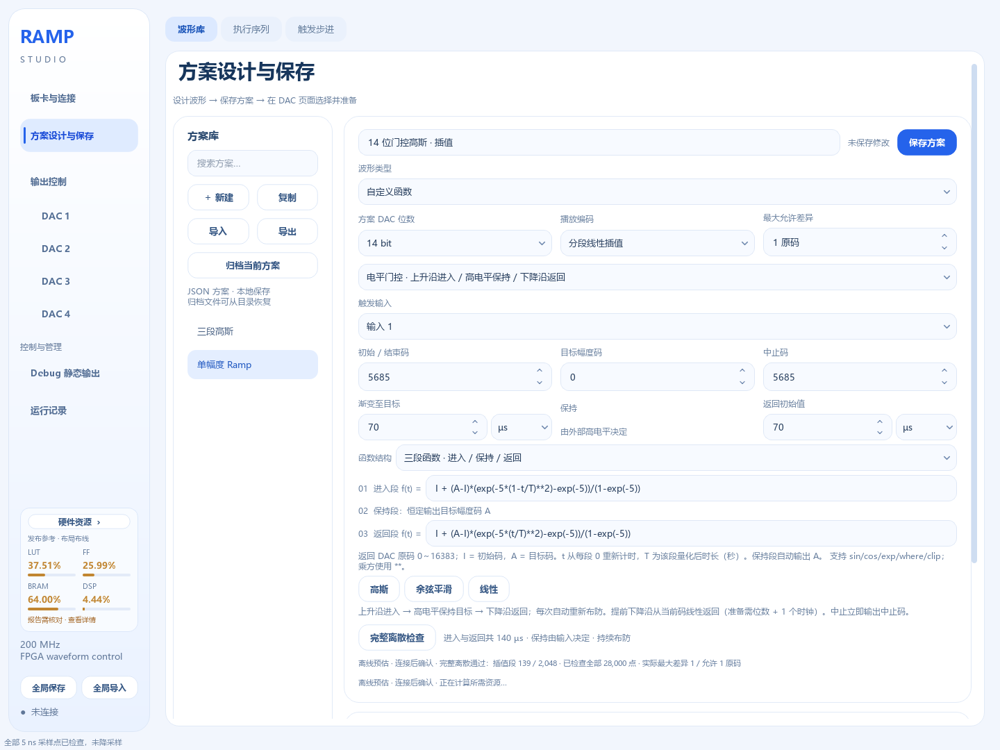

# 14 位高斯分段插值：保持每路 2048 段容量

本功能为 Ramp 和自定义函数新增“分段线性插值”播放编码。FPGA 仍每 5 ns 输出一个原码，但存储目标码和该段的持续拍数，由 FPGA 生成中间原码。四路配置仍是每 DAC、每 bank 2048 个槽位，不增加外部 RAM。

**当前发布参考固件 `release/FPGA-XC7A35T-TriggerScan/` 不支持新插值模式。** 更新上位机、导入方案或将位数选为 14 位，都不会升级板上固件。首次使用需要用新源码构建匹配的固件，并核对资源、时序及接口后另行烧录。本次开发没有自动烧写 FPGA 或 Flash，也没有实际 DAC 模拟输出验收。

## 1. 导入示例与操作

示例文件：[`examples/interpolation/14bit_gaussian_gate.json`](../examples/interpolation/14bit_gaussian_gate.json)。这是一个新的独立方案，不覆盖既有实验文件。

便携包中同一文件位于 `插值示例/14bit_gaussian_gate.json`。



1. 在“方案设计与保存 → 波形库 → 导入”选择上述 JSON。或者新建“三段自定义函数”，将“方案 DAC 位数”显式设为 14 位、“播放编码”设为“分段线性插值”。
2. 设置“最大允许差异”为 **1 原码**。本值指相对于原完整采样取整结果的逐点差异，不是电压值。
3. 设置初始 / 结束码 **5685**、目标幅度码 **0**、中止码 **5685**，进入和返回分别为 **70 µs**。中止码是明确保存的参数，可按实验需求单独设置，不随目标码自动变化。
4. 选择“电平门控”，触发输入按实际接线选择。该示例默认为输入 1；上升沿进入、高电平保持、下降沿返回。保持时间由外部高电平决定，预览中的平台仅为示意。
5. 进入函数填写：

   ```python
   I + (A-I)*(exp(-5*(1-t/T)**2)-exp(-5))/(1-exp(-5))
   ```

   返回函数填写：

   ```python
   I + (A-I)*(exp(-5*(t/T)**2)-exp(-5))/(1-exp(-5))
   ```

   `t` 和 `T` 为本阶段的秒数；`I`、`A` 为初始码和目标码。进入结束为 `A`，返回结束为 `I`。
6. 点击“完整离散检查”。此示例当前结果为 **139 / 2048 个插值段，全部 28,000 点检查通过，实际最大差异 1 原码**。离线结果标注为预估；连接后的容量和插值能力以设备 INFO 回报为准。
7. 点击“保存方案”，在各 DAC 页选择保存版本。板卡必须配置为实际使用的 14 位接口，补齐相应数据线和时序。软件不会将既有 10 位方案、原码或引脚自动变为可用的 14 位实验。
8. 确认板上固件支持插值后，连接设备并选择“准备 DAC n”或“准备所选”。准备 / 下载会重新读取设备能力并检查全部所选方案；检查失败时不开始写入新的波形。就绪后再发送外部触发。

修改方案后需再次保存和准备。普通串口下载写入 RAM，重用相同波形时不需要反复下载；掉电保存仍须将保存版本纳入上电快照，构建并另行固化匹配的 Flash 镜像。具体流程见 [Flash 固化与启动](Flash固化与启动.md)。

## 2. 新编码与精确整数输出

设某段起点为 `S`、目标原码为 `E`、持续拍数为 `N`。第一段的 `S` 为波形初始码，其余段的 `S` 为上一段目标码。描述符仍只存储 `(E, N)`。

每段占用 N 个核心时钟，样本下标从 0 开始：

```text
k = 0, 1, …, N−1
code[k] = floor(S + (E−S) × k / N + 1/2)
        = S + floor(((E−S) × k + floor(N/2)) / N)
```

第二式中的除法是向负无穷取整。FPGA 使用等效整数商余数累加，不使用浮点数。该定义适用于正斜率、负斜率和常值。14 位原码为非负整数，恰好半码时向较大原码取整：例如 `S=3, E=0, N=32, k=16` 输出 **2**，不能用 `S−round(abs(E−S)×k/N)` 得到错误的 1。

本段不另发一个 `k=N` 的样本。下一段在紧接的一个时钟输出它的 `k=0`，即本段目标 `E`，没有隐藏停顿拍。完整固定波形结束后恢复初始码；重复时直接从初始码开始下一轮。正常门控进入段结束后保持目标码，返回段完成后恢复初始码并重新准备。

连续两个相同目标码的插值描述符不能像 RLE 那样随意合并。例如第一段还在接近该目标，第二段已是恒值，合并会改变斜率和时长分配。

每个非零插值段至少 **32 拍 / 160 ns**，拍数存储上限仍为 `2^32−1`。进入、返回及固定模式的非零保持阶段也须能满足最短段要求；不通过添加等待拍凑时长。单波形完整采样仍最多 2 亿点，即 1 秒；门控只计算进入和返回，两者合计最多 1 秒，高电平保持不展开。

旧逐码保持仍允许 1 拍描述符。旧 10 位分段 / FM 引擎的最短更新间隔与本插值模式是独立限制，不作为 14 位、200 MHz 插值能力依据。

## 3. 精度检查与编译策略

旧路径先按 200 MHz 计算并取整，再将连续相同原码合并为 RLE。新路径直接访问同一个完整采样函数，在整数时钟节点取整，按上述精确整数规则重建候选直线，然后与原完整采样取整结果逐点比较。计算可以分块执行，但不能用预览点或节点检查替代完整检查，也不会先生成受 8192 段限制的 RLE 表。

当前实现从各阶段端点开始，对未达精度的区间二分细分。所有接受区间的每一个样本均须通过。默认最大允许差异为 1 个当前 DAC 原码；设置为 0 时要求原取整采样逐点完全相等。容量不足或当前节点划分无法在最短段限制内继续细分时明确报错，不自动放宽精度、不延长波形、不更改初始码或目标码。

**二分节点策略不保证全局最少段数，也不是任意节点算法无解的数学证明。** 139 段是当前示例的具体编译结果，256 段不是任意函数的通用保证。很快的变化、跳变、窄脉冲可能无法满足最短段及精度约束。整段自定义函数的 `t=0` 如果与初始码之差超过允许误差，会被拒绝；新模式不隐式插入一次跳变。

原函数的整数基准沿用当前浮点采样及 `floor(raw+0.5)` 规则。极少数数学半码点可能受浮点计算影响，因而“数学上为直线”也不保证与旧样本在误差 0 下完全一致；检查不会忽略这种差异。

界面显示“插值段数 / 设备容量”“最大允许差异”和“完整检查点数、实际最大差异”。预览仍是原函数抽样参考，不能据图形平滑程度判定完整误差；无 ADC 回采时，图形、状态回报码与数值误差均不代表模拟电压测量或 DAC 线性度。

## 4. 门控、提前下降与忙时边沿

正常门控流程为：就绪后新上升沿 → 播放进入插值表 → 高电平保持目标 → 下降沿播放正常返回插值表 → 初始码 → 自动预取并等待下一次新上升沿。保持不占额外描述符，不按时间生成几亿个重复点。

进入未完成就下降时，沿用已有门控语义：锁存当前输出码 `C`，从 `C` 线性返回 `I`，不跳到目标码，也不截取一段预设高斯尾部。提前返回保留原来的 **B+1 拍准备时间**，14 位为 15 拍 / 75 ns，准备期间保持 `C`；随后采用原整数公式：

```text
C + sign(I−C) × floor(abs(I−C) × k / N), k=1…N
```

`N` 为设置的返回拍数。此提前返回采用幅差向下取整，区别于正常表段的四舍五入；终点仍精确为 `I`。它属于既有提前下降行为，不能将正常完整高斯的 1 原码误差报告用于声称提前返回仍贴合高斯。

布防前已经为高电平不直接启动。进入 / 保持 / 返回中的额外上升沿不抢占播放，返回中的下降沿不重新开始返回。重新布防和事件步骤切换存在准备阶段；应按状态中的 `prepared` 确认就绪，准备期间的边沿不排队，不能用 5 ns 采样周期推断允许任意相邻触发。物理触发还经过输入同步和 DAC 输出寄存，实际响应延迟须另做实板测量。

取消布防只适用于等待状态，恢复初始码；中止适用于等待或运行，立即结束硬件播放逻辑并输出已提交中止码，不再自动布防。串口发出中止存在通信延迟；断开电脑不自动停止硬件。

## 5. 四路、存储池与执行序列

四路配置保持每 DAC **2048 个有效槽位**。活动 bank 与待提交 bank 各自有 2048 槽；双 bank 用于完整事务提交，不能当成 4096 段波形容量。通道不能互借槽位。14 位描述符仍为 **14 位目标码 + 32 位持续拍数 = 46 位**，内存字布局为 `[45:32]=target, [31:0]=ticks`。

事件序列的各波形共享本通道同一存储池。相同描述符内容、播放模式、初始码和门控分界的波形可以复用；相同数值但保持 / 插值含义不同的描述符不能错误共享为同一种播放。改变触发输入不需要复制相同波形表。步骤数限制与波形池容量独立，64 个步骤不意味着容量乘 64。

事件序列允许不同步骤混合逐码保持和插值。每步保留自己保存快照的播放模式和精度，步骤标志决定对应播放器。多个步骤可以全部使用输入 1，也可以分别使用输入 1、输入 2；只响应当前就绪步骤的输入，提前到来的后续步骤边沿不排队。完整返回后才推进门控步骤；忙时规则沿用原事件引擎。所有波形的位数和初始码仍需与序列一致。

固定时间表当前支持以下范围：

- 全部子波形均为逐码保持，维持原拼接行为。
- 全部子波形均为插值，保留逐段时长与重复，等待使用恒值插值段。
- 保持 / 插值混合时间表明确拒绝；可改为事件序列，或显式创建使用一致模式的波形副本。
- 插值子波形最后目标必须回到序列初始码。非零等待空隙至少 32 拍；极长等待仍拆为合法 u32 拍数，不增加隐藏时间。
- 时间表中的重复会按实际拼接段数检查容量；事件序列重复引用同一波形则共享池地址。

## 6. 保存与协议

新方案 JSON 增加：

```json
{"playback": "linear", "interpolation_error": 1}
```

旧文件缺少字段时按 `playback="hold"`、`interpolation_error=1` 读取。默认旧方案导出及指纹不增加这两个字段，保留旧版本匹配。启用插值是显式操作，不自动改变 DAC 位数、原码、精度或已有实验方案。序列将这些字段保存在各步骤的波形快照里。

协议继续使用固定 32 字节帧、版本 1、CRC 和小端编码。新模式需同时确认能力和新命令：

| 字段 / 命令 | 定义 |
|---|---|
| INFO 负载 byte19 bit0 | 分段线性插值能力 |
| INFO byte20 | 最短插值段拍数，本实现 32 |
| INFO byte21 | 插值协议修订号，本实现 1 |
| `0x34 BEGIN_LINEAR` | 固定插值波形 / 纯插值时间表，负载同 `0x30 BEGIN_RUNS` |
| `0x35 BEGIN_LINEAR_GATE` | 插值门控，负载同 `0x32 BEGIN_GATE` |
| `0x52 BEGIN_SEQUENCE_LINEAR` | 允许步骤混合的事件序列，负载同 `0x50 BEGIN_SEQUENCE` |
| `0x51 WRITE_STEP` 最后 u16，负载 byte22～23 | bit0=1 为该步骤插值；0 为保持；其余位为 0 |
| `0x31 WRITE_RUN` | 保持旧布局；新模式下原码字段为目标码，拍数字段为 N |
| STATUS byte20 bit1 | 当前播放器为插值；事件序列随当前步骤变化 |
| STATUS byte22 bit7 | 插值等待状态已准备就绪；事件序列沿用现有 prepared 定义 |
| 每 DAC `BOOT_CONFIG` bit7 | 单波形插值，或事件序列允许插值步骤 |

旧固件对三个新 BEGIN 返回“不支持”，不能退回旧 BEGIN 将目标码当作恒码播放。新版使用旧 `0x50` 时仍要求步骤末字段为 0；只有新 `0x52` 可接受插值步骤标志。

COMMIT 前检查线性引用段的最短拍数；门控还检查进入最后目标等于保持目标、返回最终目标等于初始码、返回描述符时长之和等于配置返回拍数。不完整或不合法事务不切换 active bank。新 boot 快照继续生成 46 位 `.mem`，事件步骤另有 `.mem.steps`，不扩充每路槽位。

完整字节表与兼容规则见 [协议 v1](协议-v1.md) 的“分段线性插值扩展”章节。

## 7. 当前验收记录与边界

对本例直接计算全部 28,000 个采样点，数值测试结果为：

| 路径 | 总段数 | 相对于原完整采样取整结果的最大差异 |
|---|---:|---:|
| 原 10 位逐码保持，I=355 | 712（356 + 356） | 0 |
| 原 14 位逐码保持，I=5685 | 11,372 | 0；超过容量与旧编译上限，不能下发 |
| 均匀 64 段 / 程整数节点 | 128 | 2 个原码 |
| 均匀 128 段 / 程整数节点 | 256 | 1 个原码 |
| 当前自适应编译，允许差异 1 | **139（70 + 69）** | **1 个原码** |

自适应最短段为 109 拍；进入 / 返回各 14,000 拍，时长分别保持 70 µs。上述 10 位和 14 位逐码保持计数由原采样完整统计得到，测试未提高旧编译器 8192 上限。段数因浮点采样与节点策略可能随后续版本变化，验收标准为全部点差异不超设置且不超过每路容量。

软件验证入口：`tests/test_interpolation_compiler.py` 与 `tests/test_linear_protocol.py`。覆盖数值复现、全点检查、正负整数与半码、最短段、常值、连续衔接、精度 / 容量拒绝、旧模式、能力刷新、四路协议、门控事务、事件复用与 boot 存储。

RTL 验证入口为 `tests/test_linear_engine.py`、`tests/test_linear_controller.py` 和 `tests/test_linear_event_boundaries.py`。真实高斯的 139 个描述符保存在 `tests/fixtures/linear_gaussian_adaptive.mem`，仿真输出的全部 28,000 点与软件整数预期逐拍一致。额外覆盖正负斜率、常值、32 拍短段、长时长算术、端点、连续衔接、中止、有限 / 无限重复、正常门控、提前下降、四路与事件步骤。事件测试确认准备期及忙时边沿不会排队或提前推进。

u32 极长时长用前 96 拍及注入数学状态后的末尾 4 拍检查算术与结束边界，没有连续仿真数十亿拍；真实高斯的 28,000 点则全部连续播放并逐拍比较。

`tests/test_gate_cycle_compatibility.py` 和 `tests/test_sample_cycle_compatibility.py` 使用固定保留的发布原版 RTL，逐拍核对 10 / 12 / 14 位下的旧输出与控制行为；基准不随生产优化而改写。相关软件、界面、协议及 RTL 回归合并去重为 **566 项通过、1 项跳过**；跳过的是本机 Windows 未获创建符号链接权限的测试，ZIP 链接条目拒绝仍已通过。

2026-09-16 补充全局保存的链接防护验证：新增 4 项普通权限策略测试（仅模拟链接检测，实际执行保存与拒绝流程）和 2 项真实 NTFS 目录联接测试，全部通过。该测试文件复跑为 **46 项通过、1 项跳过**。真实文件符号链接集成测试仍因 Windows `winerror=1314` 缺少创建权限而跳过，不能用模拟或目录联接测试代替这项实测；其他创建错误现在直接失败。此补充只修改测试和文档，未改变 EXE、FPGA 源码或系统权限。记录见 [链接权限补充检查](validation/linear14/symlink-followup.json)。

`tests/test_linear_cycle_compatibility.py` 另以优化前冻结的插值 RTL 为对照，在 10 / 12 / 14 位、固定和门控模式下随机组合触发、布防、取消、中止与有限 / 无限重复，核对读请求、索引、准备状态、输出码、运行阶段及计数器的逐拍一致性。单拍复位上电、参数入队同拍取消也有专门回归覆盖。

并行控制器复用始终与原缓存同值的响应寄存器，减少重复存储及写使能扇出。`tests/test_parallel_cycle_compatibility.py` 使用冻结的修改前控制器，逐拍比较全部答复位、有效信号及四路 DAC；覆盖重发、同序号不同请求、背压、忙时重试和答复待发期间复位，确认内容与拍序兼容。

四路控制器已禁用旧 10 位分段协议，本轮补齐其 `WRITE_SEG` 的常量禁用条件，以裁掉不使用的旧计算通路。默认启用旧协议的独立控制器保持原行为；`tests/test_legacy_disabled.py` 另确认禁用时的明确拒绝，以及活动 / 待提交两 bank 不被无效命令改动。

从项目根目录重跑软件及 RTL 回归（需 Python 测试环境、Icarus Verilog）：

```powershell
.\.venv\Scripts\python.exe scripts/run_regression.py --output build/regression
```

四路 14 位完整数字核心的综合与布局布线入口如下，仅生成检查报告和 checkpoint，不执行烧写：

```powershell
& 'E:\Software\Xilinx\Vivado\2023.1\bin\vivado.bat' -mode batch -source scripts/vivado/check_linear_core.tcl -tclargs rtl/common build/linear14-check
```

**四路 14 位资源与时序：Vivado 2023.1，xc7a35tfgg484-2，布局布线结果。** 基线与新版均为 200 MHz、四路 14 位、每 bank 每路 2048 段，检查包装器未内置实验上电波形。基线使用修改前源码，不拿已发布 10 位固件的资源直接比较。

**快照范围更新（2026-09-16）：** 下方四路14位资源与时序数字对应本节原始RTL快照。本轮后续将插值误差初值提前到PREPARE阶段预计算，该优化的新增布局布线和实板数字证据是 **4×10 bit**，见[已连接板卡数字验证](已连接板卡数字验证_2026-09-16.html)。优化后RTL已回归含14位的逐拍仿真，但尚未重新综合、布局布线验证当前14位物理时序；不能将历史14位通过结果直接视为更新后源码或EXE内嵌RTL的14位物理验收。

| 资源 | 修改前四路 14 位基线 | 新版四路 14 位 | 变化 | 新版器件占比 |
|---|---:|---:|---:|---:|
| LUT | 8,078 | 12,284 | +4,206 | 59.06% |
| FF | 11,207 | 14,571 | +3,364 | 35.03% |
| BRAM · 36 Kb 等效 | 34 | 34 | +0 | 68.00% |
| DSP | 4 | 4 | +0 | 4.44% |

BRAM 按 36 Kb 等效块统计，实际占用和变化见表及原始资源报告。插值增加运算、校验和预取逻辑，同时清理已禁用的旧分段计算通路并复用等价的答复缓存。波形槽位与 46 位描述符保持不变，没有以增加每路容量换取结果。为缩短 RAM 使能控制路径，同一个同步读口每拍读取，数据仍仅在请求有效时消费，读延迟与活动 / 待提交隔离保持不变；空闲时读口也活动，动态功耗尚未测量。

四路完整数字核心内部建立时间裕量 **+0.006 ns**、保持时间裕量 **+0.056 ns**，在 5.000 ns 时钟约束下通过。检查包含 UART 帧链路、输入同步、四路所有播放器 / 控制器和 DAC 输出寄存器；使用实际布局布线 BUFG 时钟树，覆盖寄存器、BRAM、DSP 的内部路径，包含 CE 和同步复位端，不仅检查数据 D 引脚。

此次内部建立时间裕量仅 6 ps，余量很小。它是该器件、该源码与本次实现结果的通过记录，不保证其他布局种子、器件、时钟来源或板卡配置也能通过。正式用于实验前仍须在实际顶层、引脚与时钟约束下重新实现并验收。

基线与新版均保留 5 ns 时钟和 1 ns IO 预算，并使用 core_internal 路径分组检查内部路径；分组使用全部内部寄存器 / BRAM / DSP 集合，不切断路径、不改变时钟或 IO 预算。查询多个路径组时显式取最小裕量，避免分组后误把其他组的正裕量当作全局通过。实际使用的分组时点、物理优化及完整命令见 [复现记录](validation/linear14/REPRODUCE_CORE.md)；不同布局和优化流程的具体裕量可能不同。

修改前 14 位基线的内部 setup 为 -0.104 ns、hold 为 +0.055 ns。该基线未通过此次完整内部 200 MHz 检查，保留它用于同配置资源与改动前行为对照；不能把旧 10 位发布固件的时序结论套用到 14 位。

这是数字核心内部时序结果。保留 1 ns 输入 / 输出预算的完整 OOC 报告为 setup **-0.267 ns**、hold **-0.880 ns**，边界路径未签核；异步复位 / UART / 触发端口的该预算不是实物约束。没有删除失败路径或降低核心频率。MMCM、引脚、电平、DAC 转发时钟与外部建立 / 保持时序不在本次内部通过范围，不能将本结果称作完整板级时序验收。

可核查的 [验收摘要](validation/linear14/summary.json)、[新版资源](validation/linear14/linear/utilization.rpt)、[内部建立时间](validation/linear14/linear/internal_setup.rpt)、[内部保持时间](validation/linear14/linear/internal_hold.rpt)、[完整边界报告](validation/linear14/linear/timing.rpt) 与 [旧版基线](validation/linear14/baseline/utilization.rpt) 随文档交付。同目录保留 BRAM / DSP 路径、检查包装器及源码 SHA-256；时序路径正文完整，仅去掉展开数万个单元名称的重复命令头。开发目录的原始报告与 routed checkpoint 完整保留。

**实板状态：本任务未烧写 FPGA 或 Flash，未测量实际 DAC 电压、触发延迟或模拟波形。** 1 原码数字差异不等于 1 原码对应的模拟电压精度。14 位新增数据管脚、IO 电压、DAC 建立 / 保持条件、板级信号完整性仍需对应真实硬件核对和验证。
