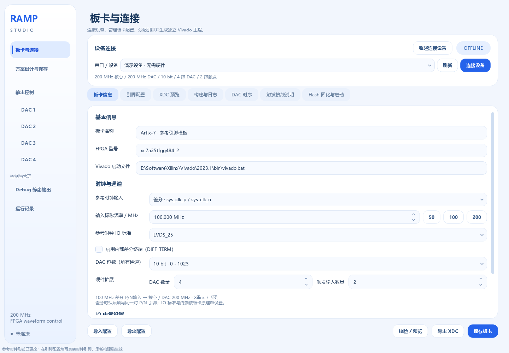
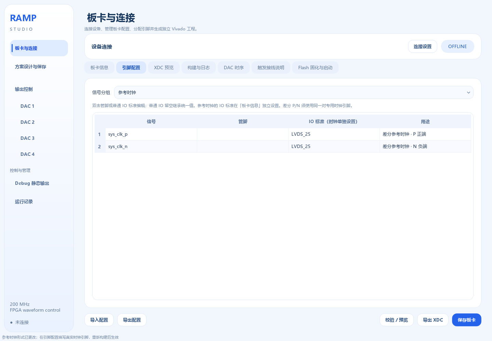

# Ramp Studio · 参考时钟配置

本版本支持 Xilinx 7 系列的单端或差分参考时钟，提供 **50 / 100 / 200 MHz** 快捷设置，也可手动输入频率。核心和所有 DAC 共用的输出采样率现可选 **100 / 125 / 200 MSPS**，每点对应 **10 / 8 / 5 ns**。设置入口、重新构建步骤见 [输出采样率与 3PD5651E](输出采样率与3PD5651E.md)。

当前这块板继续使用 **单端 50 MHz、sys_clk → R4**。只保留旧 200 MHz 输出时无需重烧；使用 3PD5651E 必须重新构建并烧写 100 / 125 MSPS 固件；换用另一种参考时钟时，必须按新板卡生成并烧写对应固件。

## 1 输入时钟与 DAC 时钟的区别

| 实际参考输入 | 输入形式 | 核心 / DAC 时钟 | 固件中的处理 |
|---|---|---|---|
| 50 MHz | 单端或差分 | 100 / 125 / 200 MHz | MMCM 按所选目标配置 |
| 100 MHz | 单端或差分 | 100 / 125 / 200 MHz | MMCM 按所选目标配置 |
| 200 MHz | 单端或差分 | 100 / 125 / 200 MHz | MMCM 按所选目标配置并处理锁定、复位 |

“参考时钟”是板卡送入 FPGA 的实际振荡器频率；填写 100 MHz 不会把一个 50 MHz 振荡器变成 100 MHz。程序不自动测量输入频率，请按板卡原理图或振荡器规格填写。多个 DAC 共用这一参考时钟，不能在同一工程中分别选择不同参考源。

手动输入范围为 10～500 MHz。这是软件录入范围，最终能否产生所选输出频率，仍由所选 FPGA 型号、速度等级和 Vivado Clocking Wizard 校验。

## 2 在哪里设置

1. 打开 **板卡与连接 → 板卡信息**，填写准确的 FPGA 型号和本机 `vivado.bat` 路径。
2. 在“时钟与通道”选择“参考时钟输入”：单端或差分。
3. 在“输入标称频率 / MHz”填写实际频率，或点击 50、100、200 快捷按钮。
4. 设置参考时钟自己的 IO 标准；差分输入还可设置内部终端。
5. 打开 **引脚配置**，把“信号分组”切到 **参考时钟**，填写实际时钟管脚。
6. 点击“校验 / 预览”，检查 XDC，再点击“保存板卡”。保存、导出和导入的 JSON 包含时钟形式、频率、IO 标准、终端及引脚。

引脚和板卡信息保持独立页面。切换单端／差分时保留各自已填写的引脚；只将当前输入形式的引脚写入 XDC。首次切换差分时 P/N 留空，不从旧 sys_clk 猜测接线。

## 3 单端输入

选择 **单端 · sys_clk**，在“引脚配置”中为 `sys_clk` 填写该板卡的专用时钟输入管脚。

参考时钟 IO 标准可以继承统一 IO 标准，也可独立选择 LVCMOS33、LVCMOS25、LVCMOS18、LVCMOS15 或 LVCMOS12。例如 DAC 使用 LVCMOS33，而振荡器提供 1.8 V 单端时钟，应按实际 Bank 条件为时钟单独选择 LVCMOS18。

## 4 差分输入

选择 **差分 · sys_clk_p / sys_clk_n**，分别填写时钟正端 P 和负端 N。两者必须属于所选 FPGA 封装上的**同一对专用时钟输入**；两个普通 IO 不能任意组合，P/N 也不能反接。

参考时钟 IO 标准独立选择 LVDS_25 或 LVDS，按该板的时钟信号、IO Bank 类型和供电确定；软件不把 DAC 的 LVCMOS33 自动套给差分时钟。时钟 IO 标准在“板卡信息”中统一设置，引脚表中的对应两格仅显示结果。

“启用内部差分终端（DIFF_TERM）”默认关闭。是否启用应依据板卡已有终端和 FPGA Bank 电气条件确定，不能把“差分输入”简单等同于“必须开启内部终端”。Xilinx 的 IBUFDS 用于把 P/N 转换成 FPGA 内部时钟；它的 IO 标准、内部终端和低功耗属性可通过端口约束设置。参见 [AMD IBUFDS 原语说明](https://docs.amd.com/r/en-US/ug953-vivado-7series-libraries/IBUFDS)。

## 5 生成工程与烧写

修改输入形式、参考频率、时钟 IO 标准或接线，都会改变 FPGA 硬件配置。操作流程：

1. 保存板卡配置，补齐全部引脚和 DAC 时序参数。
2. 在“构建与日志”生成新工程并综合。
3. 综合后，程序用 Vivado 器件数据库检查已填写的时钟管脚是否具备时钟能力；差分输入还检查原始 P/N 的配对与极性，再与综合后的引脚比较，防止工具自动调整到另一对引脚。未填引脚的草稿会提示尚未检查配对。
4. 完整实现，检查 DRC 与时序通过后生成 bitstream。没有补齐 DAC 输出时序的工程仍不能据此认定整板时序通过。
5. 用新 bitstream 配置新板；若需掉电后继续使用，再按“Flash 固化与启动”流程更新 Flash。

普通波形下载仍走串口写入 FPGA 内部存储，不需要每次重烧 bitstream。只有这里的硬件时钟配置变更才需要新固件。

上电波形快照使用同一份板卡时钟配置：差分 P/N 会出现在上电顶层，快照清单记录参考时钟设置。它不会退回默认的单端 50 MHz。

## 6 生成内容与配置迁移

| 配置 | 顶层端口 | 输入处理 | XDC 基准时钟 |
|---|---|---|---|
| 单端 | sys_clk | Clocking Wizard 输入缓冲 → MMCM | 在 sys_clk 上创建一次 |
| 差分 | sys_clk_p、sys_clk_n | IBUFDS → Clocking Wizard（No_buffer）→ MMCM | 仅在 sys_clk_p 上创建一次 |

差分模式只使用一个物理输入缓冲，避免重复缓冲；DAC 的生成时钟约束会跟随普通顶层、差分顶层和上电快照顶层的层级自动更新。200 MHz 输入同样保留 MMCM 锁定和复位同步。

板卡 JSON 新增 `clock_input`、`clock_io_standard`、`clock_diff_term` 三个字段，版本为 schema 3。此前 schema 1/2 的文件可直接导入，默认按单端输入解释，原频率及引脚保留。旧文件里对 sys_clk 的独立 IO 覆盖也会保留；不需要手工修改旧实验数据。

迁移到另一台电脑时，复制整个 `release`，包括其中的 `user_data`；新电脑重新选择 Vivado 路径即可继续使用保存的时钟配置。具体目录见 [迁移到其他电脑](迁移到其他电脑.md)。

## 7 支持范围

当前构建适配器支持 **Xilinx 7 系列**。增加差分和多种频率输入，不等于已经适配 Intel FPGA、UltraScale 或所有其他器件；这些器件需要另外实现对应的时钟、IO 原语和工具链适配。

本机原四路固件继续对应单端 50 MHz，`release/FPGA-XC7A35T-TriggerScan/` 中的现有镜像不能直接用作未知差分板卡的固件。新板需要自己的准确器件型号、P/N 引脚、IO 标准和输出时序。本功能的软件、时钟 IP 仿真与综合检查不替代新板的实际接线和 DAC 输出验证。

## 8 本版本验证记录

验证环境：Vivado 2023.1、xc7a35tfgg484-2、四路 10 bit 数字逻辑。仿真使用实际生成的 Clocking Wizard 和 Vivado MMCM、IBUFDS、ODDR 模型。

| 输入形式 | 参考频率 | 普通 / 上电快照 | 时钟仿真 | 综合与 XDC 层级 |
|---|---|---|---|---|
| 单端 | 50 MHz | 普通 | 通过 | 本轮未重复综合 |
| 单端 | 100 MHz | 普通 | 通过 | 本轮未综合 |
| 单端 | 200 MHz | 上电快照 | 通过 | 本轮未综合 |
| 差分 | 50 MHz | 普通 | 通过 | 本轮未综合 |
| 差分 | 100 MHz | 普通 | 通过 | 通过 |
| 差分 | 200 MHz | 上电快照 | 通过 | 通过 |

六种组合均确认锁定后释放复位、四路转发时钟相位一致、周期 5 ns / 高电平 2.5 ns，以及 DAC 数据在共享的 200 MHz 边沿寄存。两份差分综合设计均确认只有一个 IBUFDS，核心与四路 DAC 生成时钟约束正确；已验证正确配对、错误配对及反向 P/N 的检查。

210 项软件与 RTL 回归通过，覆盖板卡保存、旧配置兼容、波形、触发、序列、Flash 设置等；修改引脚传参后又完成 25 项相关复查。六个界面状态覆盖 1440×1000 和 1080×700，未发现横向溢出，当前四路 50 MHz 模板的 XDC 与更新前逐字节一致。

发布 EXE 通过中文及空格路径、搬移目录、无 Python/Qt PATH 的离屏和 Windows 后端自检；另通过“EXE → 内置构建进程 → 实际 Vivado”生成差分 100 MHz 上电方案工程。验证证据位于开发仓库的 `build/clock_input_release/`。

以上未对新板做布局布线时序签核或模拟电压实测，本轮没有连接串口、JTAG 或写入 Flash。
