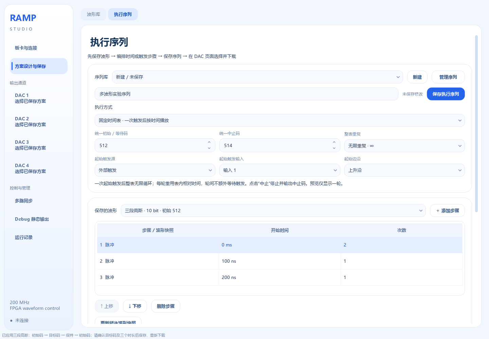
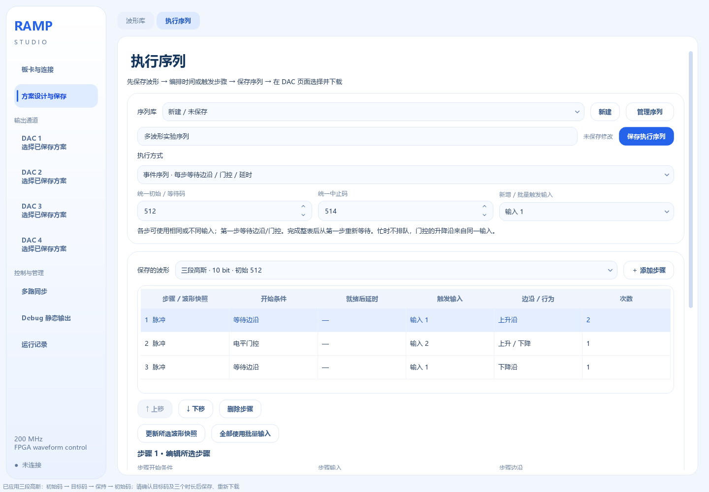

# 执行序列：单 DAC 多波形与独立触发输入

版本：2026-09-12。新增功能的使用入口为 **方案设计与保存 → 执行序列**。

## 1. 选择哪一种方式

| 执行方式 | 行为 | 固件要求 |
|---|---|---|
| 固定时间表 | 一次起始触发后，按预设时间播放 A、B、C；间隔保持统一初始码；可指定整表次数或无限重复 | 指定次数兼容现有采样播放器；无限重复需要 INFO bit6=1 的新版固件 |
| 事件序列 | 每个步骤分别等待指定输入的边沿，或执行门控；完成后进入下一步 | 新版序列固件，INFO bit5=1、byte18 回报最多步骤数 |

当前设计最多 64 个步骤。每路 DAC 可以使用不同序列，原来的单波形方案仍可使用。所有波形提前下载，FPGA 自主播放；电脑不会在步骤间实时下载下一波形。

便携包的“序列示例”文件夹提供四个 10 位 JSON。进入执行序列页点击“导入”，即可查看固定时间表、无限重复时间表、不同输入以及共用输入的完整配置；导入和保存不会输出 DAC。


“管理序列”集中提供复制、导入、导出和归档。表单会按窗口宽度排列；固定时间表只编辑开始时间与步骤次数，事件序列按边沿、门控或延时显示对应参数。点击表中某一步后，下方控件立即切换到该步骤；没有步骤时不提供可编辑的空参数。

切换到同一序列会保留当前草稿；选择另一序列、新建或导入前，如有未保存修改，可选择保存、放弃或取消。无法保存的参数不会被当作已保存版本执行。

## 2. 保存一个固定时间表

1. 在“波形库”保存所需 Ramp 或自定义函数。第一版要求同一序列的所有波形采用相同位数和初始/结束码。
2. 进入“执行序列”，点击“新建”，填写名称和统一初始/等待码、中止码。
3. 执行方式选择“固定时间表”。选择起始触发源、输入及上升/下降沿；也可选择软件触发。
4. 从“保存的波形”选择模板，点击“添加步骤”。
5. 点击表中某一步，在下方设置它的开始时间和步骤内重复次数。时间从序列的共同起点计算，ns/µs/ms/s 均可切换。
6. 按表内顺序设置后续步骤。开始时间不能早于前一步实际结束时间；软件按 5 ns 量化后再检查重叠。
7. 在“整表重复”选择“指定次数”并填写次数，或选择“无限重复 · ∞”。完成完整离散/容量检查，保存序列。
8. 打开 DAC1～4 中所需通道，在“使用方案”选中该序列，下载、布防，然后触发。

例如：A 在 0 ms 开始、持续 240 ms；B 在 300 ms 开始、持续 40 ms；C 在 500 ms 开始、持续 120 ms。间隔分别为 60 ms、160 ms，始终输出统一初始码。整个时间表持续 620 ms。

时间表中的各步骤共享一次起始触发。若要 A 等输入 1、B 等输入 2，使用事件序列，而不是在固定表里为每段重新设置触发。

### 整表无限重复

选择 **整表重复 → 无限重复 · ∞**，保存后到目标 DAC 页面下载、布防。外部模式收到一次所选边沿后开始，软件模式点击“软件触发”开始。此后按 `A → B → C → A → B → C → …` 持续运行，每轮使用同一份相对开始时间。

以上面的 620 ms 时间表为例：第二轮从 620 ms 开始，第三轮从 1240 ms 开始。整表末尾直接衔接下一轮，不增加隐藏等待；如果第一步开始时间不是 0，每轮都会包含这段初始码等待。各步骤内部重复次数仍独立生效。

持续播放只占一轮的存储空间，不重复下载，也不要求每轮重新触发。运行期间再来的边沿不会重启或停止它；若要下降沿返回，使用事件序列中的门控步骤。

点击该 DAC 页的 **中止**，停止并输出已下载方案的中止码；随后可重新布防，等待新的起始触发。只是断开串口或关闭软件，FPGA 会继续循环。显示的完成轮数到 65,535 后显示为 `65535+`，播放仍继续。预览只绘制一轮。

无限重复需要更新 FPGA 固件，单独替换 EXE 不会改变旧固件。连接旧设备时可以设计和保存，但软件会阻止下载并说明升级要求。事件序列本来就会回到第一步等待新事件，因此不使用这个连续无限播放选项。



## 3. 多个步骤共用同一个触发输入

选择“事件序列”，将每一步的“步骤输入”都设为输入 1；也可在顶部的“新增 / 批量触发输入”选择输入 1 后点击“全部使用批量输入”。这项批量操作只对事件序列开放。

```text
布防
  → 等待输入 1 的新上升沿 → 播放 A
  → A 完成、下一步准备好
  → 等待输入 1 的下一个新上升沿 → 播放 B
  → ……
```

同一个边沿只用于当前步骤，不会同时推进后面所有使用同一输入的步骤。第一步完成前到来的额外边沿不排队。

## 4. 每一步使用不同触发输入

按步骤分别选择接口与边沿，例如：

| 步骤 | 波形 | 开始条件 | 输入 |
|---|---|---|---|
| 1 | Ramp A | 上升沿 | 输入 1 |
| 2 | 三段高斯 B | 上升进入、高电平保持、下降返回 | 输入 2 |
| 3 | Ramp C | 下降沿 | 输入 1 |

只响应当前步骤所选输入。等待步骤 1 时，输入 2 的事件不会提前执行步骤 2；它也不会被保存为稍后的触发。各步骤按顺序执行，不是任意输入到任意波形的抢占映射。

当前参考板输入 1/2 对应 `trigger_in[0]/[1]`，已有映射为 F13/F14。以正在使用的板卡 JSON/XDC 为准。增加接口数量时，要在板卡与连接中补齐实际管脚并重新构建，不能只增加界面的输入选项。

不同 DAC 可以共享同一外部输入，也可各用不同输入。共用输入要求各通道都已准备就绪；逐路串口状态不能测量物理同步偏差。



## 5. 门控步骤

选择步骤后，将“步骤开始条件”设为“上升进入 / 下降返回”，选择该步输入，边沿设为上升、步骤内重复为 1。

上升沿开始进入段，高电平保持目标，下降沿开始返回；完整返回后才进入下一步。两个边沿来自该步骤选定的同一根输入线。进入中提前下降，仍沿用当前实现的“从当前码线性返回初始码”。

固定 Ramp 或三段函数快照可以作为门控步骤，固定保持时长由实际高电平替代。旧整段函数不能直接用于门控。未知高电平时长不能放入固定时间表，也不能用示意预览推断绝对结束时刻。

事件序列还提供“下一步就绪后延时”。它先完成内部步骤切换与预取，再等待设定时长，随后自动播放固定时长波形。因此它不是严格的“上一输出最后一拍 + 设定时长”；需要准确无缝定时衔接时使用固定时间表。第一步必须是边沿或门控步骤，避免布防命令尚未应答就自动执行。

## 6. 时间、衔接与重复

- 采样网格为 5 ns；原码四舍五入，不做电压换算或自动幅度缩放。
- 每个固定波形占用 `[开始拍, 结束拍)`，不额外插入一个隐藏终点采样拍。间隔保持统一初始码。
- 步骤内重复次数和固定表的整表重复次数分开。事件模式每步完成后推进，整个表完成后自动回到步骤 1 等待新事件，直至取消或中止。
- 事件步骤切换需要读取参数、寄存选择和预取 FIFO。准备期间不接受新触发，不承诺任意相邻两个边沿都能执行；状态包含 prepared。不要按 5 ns 网格倒推出外部触发最短间隔。
- 外部同步、FPGA 输出寄存和 DAC 都会引入延迟。实际引脚时序和模拟输出需要仪器测量。

## 7. 容量与预览

四路配置每路共用 2048 个连续码段；其他配置以 INFO 为准。固定表将各波形及等待拼接，连续同码段可无损合并；长等待拆为合法 32 位拍数码段。不会分配整段等待所对应的几亿个 NumPy 采样点。

事件模式使用一份码段池和步骤表；重复引用相同码段内容会复用地址，不复制多份波形。最多 64 步不代表每路容量扩大 64 倍。

单个函数仍受原来的 1 秒完整离散限制。固定表可通过多个合法波形和等待延长，但总量、每段计数和每路存储必须通过检查。事件步骤的就绪后延时最长为 `(2^32−1)/200 MHz`，约 21.47 s。

预览是抽样示意。步骤内重复超过 8 次时，只绘制前 8 次与实际时间范围；完整下载包含全部重复。事件等待和高电平保持时间未知，预览已标注“事件时间轴为示意”。

## 8. 保存、快照和版本管理

保存序列时连同每个步骤引用的波形快照保存，后续在波形库修改模板不会自动改变已有序列。需要更新时，选择步骤并点击“更新所选波形快照”，再检查并保存。

序列与单波形共用 `user_data/profiles/`，通过 `mode=sequence` 区分；这样现有 DAC 分配、方案归档和导入机制可以复用。未保存序列草稿位于 `sequence_draft.json`。导出序列 JSON 已包含波形快照，无需另外寻找模板文件。

下载身份覆盖序列内容和波形快照。切换开始时间或延时的单位时，保留输入数字，实际时长按新单位计算，例如 `100 ns → 100 µs`；软件随即重新检查时间表重叠。改变后须保存并重新下载确认。保存和选择操作本身不修改硬件。

## 9. Debug、中止和断开

Debug 静态输出仍会替换该通道的活动配置；恢复序列要重新下载。中止使用当前已提交序列的统一中止码，取消布防使用统一初始码。某一路中止不会停止其他 DAC。

关闭软件或断开 UART 不自动停止 FPGA。事件序列整表完成后会继续等待新事件，需要结束实验时应明确取消布防或中止。

## 10. Flash 保存完整序列

在 DAC 页展开“方案与触发设置”，选中已保存序列；在 Flash 页单独勾选要纳入的通道，点击“纳入上方所选方案”。输出控制总览的勾选不影响 Flash 纳入范围。构建时生成完整码段及事件步骤初始化数据，再固化新镜像。

固定表复用原码段存储结构；事件表额外生成 `.mem.steps` 初始化文件。它们必须和对应顶层一起参与构建，不能只把步骤文件复制到旧 `.bit` 旁边。

普通串口下载仍只写 RAM。完整从 Flash 启动后恢复固化版本，事件序列从步骤 1 等待，而不是恢复上次断电时的中间步骤。运行中逻辑复位会使活动配置失效，避免 UART 改写后的 RAM 与旧元数据错配。

## 11. 协议摘要

固定表复用 `0x30 BEGIN_RUNS / 0x31 WRITE_RUN / 0x12 COMMIT`。

事件模式使用 `0x50 BEGIN_SEQUENCE` 创建待提交事务：初始码 u16、中止码 u16、池码段数 u16、步骤数 u16、配置 ID u32、DAC 编号 u8，其余置零。随后按顺序写入 `0x51 WRITE_STEP`，再使用 `WRITE_RUN` 写码段池，最后 COMMIT。运行或布防时拒绝修改；步骤或码段不完整时拒绝提交。

WRITE_STEP 为 24 字节：

| 偏移 | 字段 |
|---|---|
| 0～3 | 步骤序号 u8、类型 u8（0 边沿固定波形 / 1 门控 / 2 就绪后延时）、输入 u8、边沿 u8 |
| 4、6 | 波形池起始地址 u16、码段数 u16 |
| 8、10 | 门控进入段数 u16、目标码 u16 |
| 12、16 | 门控返回拍数 u32、就绪后延时拍数 u32 |
| 20、22 | 步骤重复 u16、保留 u16=0 |

INFO bit5 表示事件序列，byte18 为步骤容量 64；bit6 表示无限重复。当前四路功能值为 111，带上电快照时为 127；单播放器适配器为 107，带快照时为 123。之前的 47/63、43/59 版本不支持无限重复。

固定时间表的 JSON `repeat=0` 表示整表无限重复，1～65535 保持原有有限次数语义。`BEGIN_RUNS` 负载偏移 6 的 u16 字段同样以 0 表示无限。STATUS byte23 bit4 表示活动配置的无限重复设置（需 INFO bit6）；它是配置标志，是否正在运行仍看 state。旧分段、事件步骤和单波形编辑器继续使用有限次数。

STATUS byte23 bit5 表示当前是事件序列；byte2 是当前步骤序号，byte18～19 保留码段索引；byte21 回报当前步骤输入；byte22 bit0 为边沿、bit3:1 为阶段（0 准备 / 1 等边沿 / 2 延时 / 3 播放）、bit7 为已准备好。byte23 的门控/上电来源标志保留原义。

## 12. 验证范围

本版新增测试覆盖固定表逐拍拼接、长等待拆分、快照往返、不同位数、波形池复用、错误输入/边沿、共用输入、门控正常返回、事务不完整和越界、UART 命令解码、中止、上电步骤恢复和逻辑复位保护。软件自检只使用演示设备，不改变实板输出。

实板烧写、受控外部边沿以及断电验证，须对应本版镜像另行记录。历史两路/四路固件的验收不代表本版已经通过这些实物测试。
