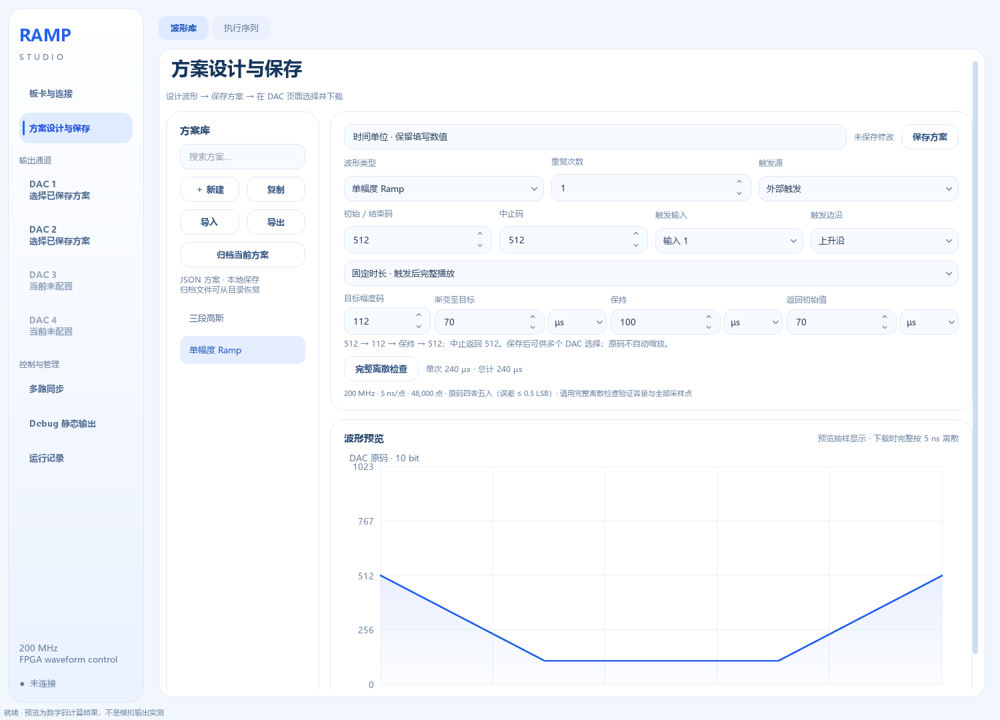

# 时间单位

渐变至目标、保持、返回初始值、旧版整段函数时长、旧版更新间隔，以及执行序列的开始时间和步骤延时，均可从输入框右侧选择 **ns、µs、ms、s**。三个阶段可以使用不同单位。

**切换单位时保留填写的数值，实际时长按新单位计算。** 例如输入 `70 ms` 后切换为 µs，输入框仍为 `70`，表示 `70 µs`；再切换为 ns，表示 `70 ns`。小数也保持不变。编辑数字后按 Enter 或移开焦点确认。

单位切换属于方案编辑，需要保存并重新下载，新的时长才会作用于 FPGA；编辑界面本身不会改变正在输出的波形。执行序列会按新时长重新检查步骤重叠。

切换后若超出允许时长，例如 `70 ms → 70 s`，保留 `70 s` 并提示参数错误，不会自动改成 `1 s`；修正后才能保存和下载。

波形设计页的单位选择记录在界面设置与草稿中，下次打开沿用。恢复草稿或加载旧方案时按已保存的实际时长显示，不会再次按单位放大或缩小时长。方案 JSON 中的时长继续使用原有 ms 字段，旧版更新间隔继续使用 µs 字段，旧方案不需要转换。迁移时复制整个 `user_data` 即可保留便携版界面设置。

波形预览的时间轴和单次/总计时长自动选择合适的显示单位。函数表达式中的 **t、T 始终以秒为单位**，不会跟随输入框的单位变化。

实际采样依旧为 200 MHz，每点 5 ns。单位切换不改变时长量化方式、最多 1 秒的采样总时长或编译器 8192 个连续码段的上限；下载还按实际设备的每路容量检查，当前四路固件为 2048 段/路。
