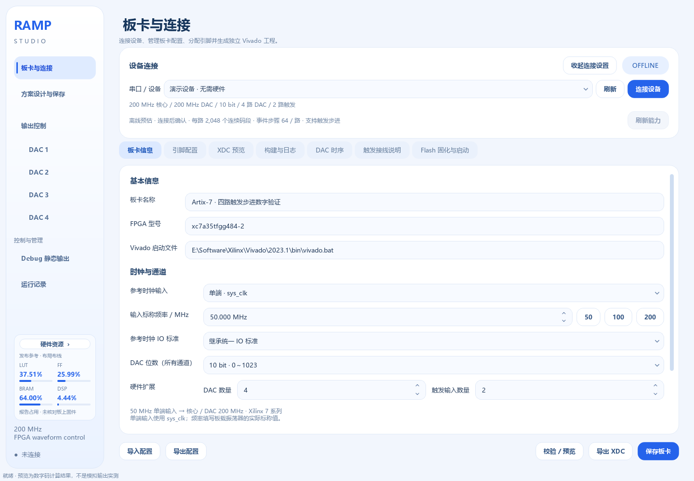
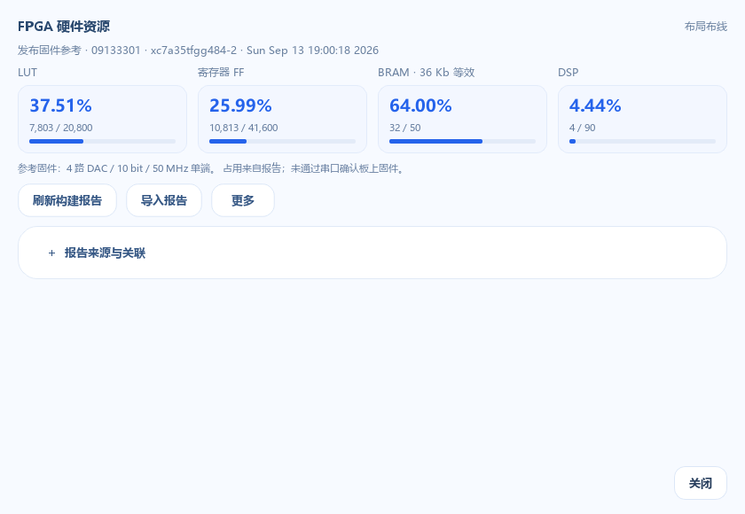

# 板卡硬件资源占用

在左侧栏底部的「硬件资源」中，可以查看当前所选 Vivado 报告的 LUT、FF、BRAM 和 DSP 占用百分比。摘要常驻显示，切换到方案设计、DAC 或其他页面后仍可查看，板卡信息页专注于配置参数。

点击「硬件资源」打开完整报告窗口，查看各项已用量、器件可用量和百分比，以及报告来源、器件型号、生成时间和处理阶段。刷新、导入及「更多」操作集中在该窗口；展开「报告来源与关联」可查看报告路径、设计名称、工具版本、SHA256 及构建关联信息。关闭报告窗口后可继续当前页面的操作。

## 读懂四项占用

| 项目 | 含义 | 单位 |
|---|---|---|
| LUT | 固件使用的查找表，包括报告计入的逻辑和分布式存储 | 个 |
| FF | 固件使用的寄存器 | 个 |
| BRAM | 固件分配的片上块存储 | 36 Kb 块等效计数 |
| DSP | 固件使用的专用运算单元 | 个 |

BRAM 优先采用 Vivado 的 Block RAM Tile 汇总行，以 36 Kb 块等效计数；`0.5` 表示半块。不要把该行与下面的 RAMB36、RAMB18 子项重复相加。综合报告和布局布线报告的结果可能不同，应同时查看报告阶段。

这些数值描述一份固件的硬件实现。通过串口下载新波形，通常只改变已分配存储器中的数据，不会重新综合逻辑，所以 LUT、FF、BRAM、DSP 占用不会随着每次波形下载而增加。

## 默认发布固件参考

对于匹配的器件型号，软件附带一份发布固件报告，便于在没有本机构建记录时查看参考值。来源会明确显示为「发布固件参考」，不能据此认定当前连接的 FPGA 正在运行这份固件。可以通过「更多 → 查看发布固件参考」主动切回此报告；器件型号不匹配时，不会用这份参考填充另一型号的资源总量。

该参考对应 `release/FPGA-XC7A35T-TriggerScan/` 中的固件：

| 项目 | 报告内容 |
|---|---|
| FPGA | xc7a35tfgg484-2 |
| 固件标识 | USR_ACCESS 09133301 |
| 配置 | 4 路 DAC，每路 10 bit；2 路触发输入 |
| 时钟 | 50 MHz 单端输入，核心 / DAC 为 200 MHz |
| 工具 | Vivado 2023.1 |
| 报告时间 | 2026-09-13 19:00:18，按原报告记录 |
| 阶段 | Routed，完成布局布线 |
| LUT | 7803 / 20800，37.51% |
| FF | 10813 / 41600，25.99% |
| BRAM Tile | 32 / 50，64.00% |
| DSP | 4 / 90，4.44% |

来源原文为 `release/FPGA-XC7A35T-TriggerScan/utilization.rpt`。这份报告不是当前源码重新构建的结果，也不代表其他通道数、DAC 位数或参考时钟配置。

## 读取自己的构建结果

1. 在「板卡信息」填写真实器件型号、参考时钟和通道数量，在其他子页完成引脚、时序等设置。
2. 进入「构建与日志」，选择「生成并综合」「核心布局布线检查」或「实现与 bitstream」并启动构建。
3. 产生资源报告后，左侧栏摘要自动更新；点击「硬件资源」查看完整占用及报告阶段。只生成工程与时钟 IP 的操作没有完整设计的资源报告。
4. 需要检查最终固件时，使用该固件对应的布局布线报告，并核对来源和生成时间。

「刷新构建报告」读取 `user_data/builds/` 中的本机构建记录，不会启动一次新的综合。「更多 → 前往生成并综合」会进入构建页面，由用户启动构建。构建成功、构建失败以及尚无综合统计会分别提示；已有资源数字不能代替构建成功结论。

「综合」说明数值来自综合后的设计；「布局布线」说明数值来自实现阶段。资源占用未超过 100% 并不等于时序和 DAC 板级接口已经验证，应结合相应构建日志及时间约束报告判断。

## 导入已有报告

点击左侧栏底部的「硬件资源」，在完整报告窗口中点击「导入报告」，选择 Vivado 生成的 `*.rpt` 文件。应选择完整设计的资源利用率报告，不要用单个时钟 IP 的报告代替整个 FPGA 固件的报告。

手动导入的报告会保留其来源。报告文件本身通常提供器件型号、设计名称、处理阶段和时间；它不能单独证明使用了当前页面里的引脚、DAC 位数、通道数量或全部源码。如果缺少可核对的配置关联信息，软件会提示尚未验证关联，不能将型号相同解释为固件完全一致。

点击「更多 → 打开原始报告」可以查看当前报告原文。导入的文件会复制到数据目录，后续查看不依赖最初的文件位置；原始来源与本机构建、发布参考会分别标注。

## 配置变化后的含义

修改会影响硬件实现的板卡配置后，旧报告仍可用于对照，但会提示与当前配置不一致或需重新构建。保存板卡配置、连接串口或重新下载波形不会更新旧报告中的占用百分比。

只有根据新配置重新综合 / 实现并读取新的报告，才能得到新固件的资源占用。更换 FPGA 型号时，也不能把之前器件的资源总量继续当作新器件总量。

## 与波形下发容量检查的区别

| 检查位置 | 数据来源 | 回答的问题 |
|---|---|---|
| 左侧栏硬件资源摘要及完整报告 | Vivado 报告 | 这份固件占用了多少芯片逻辑与片上存储资源？ |
| 设计 / DAC 页的所需与可用容量 | 连接设备的 INFO 回报，或明确标注的离线预估 | 当前波形能否装入固件为该 DAC 开放的存储？ |

例如，BRAM 使用率为 64% 并不表示其余 36% 可以直接装入更多波形。固件为各路 DAC 设置了固定存储容量；要利用更多物理存储，需要修改固件的分配并重新构建。现有的下发前检查仍按设备实际回报的容量执行。

## 迁移到其他电脑

随 EXE 附带的发布参考不依赖原电脑的 Vivado 安装目录。迁移自己的配置、方案与报告记录时，应保留并复制程序旁的整个 `user_data` 文件夹，不能只复制 EXE 或仅保存原报告的绝对路径。相关文件包括：

| 位置 | 内容 |
|---|---|
| `user_data/resource_report_selection.json` | 当前选择的报告来源，内部路径相对于 `user_data` |
| `user_data/resource_reports/<报告 SHA256>/utilization.rpt` | 手动导入报告的原文副本 |
| `user_data/builds/<工程目录>/resource_report.json` | 本机构建报告与配置、源码、生成阶段的关联信息 |
| `user_data/builds/<工程目录>/` | 对应 Vivado 工程及原始资源报告；与关联文件一起保留 |

其中 `<报告 SHA256>` 和 `<工程目录>` 表示软件生成的实际子目录名称，不要手动改成这些占位文字。常见工程目录形如 `studio_20260914_120000_123456`。按整文件夹迁移时，相对路径关联可以继续使用。

若还需要在另一台电脑继续查看原始 Vivado 工程、检查时序或重新生成比特流，应另外保留对应构建目录及源码。显示已有资源报告本身不需要连接 FPGA，也不会触发串口操作、JTAG 配置或 Flash 固化。
