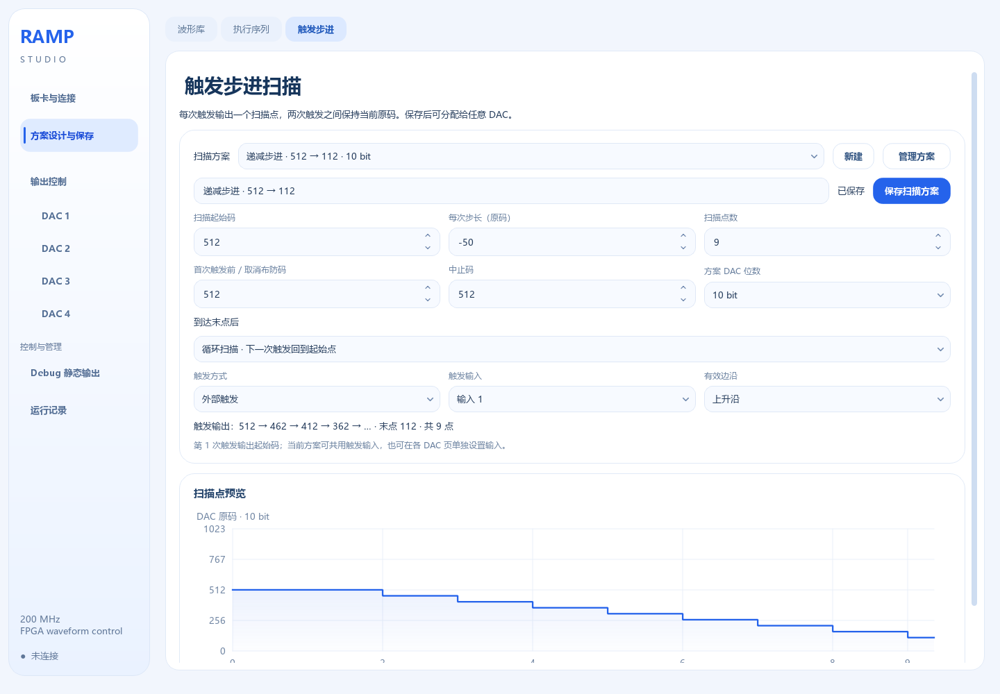
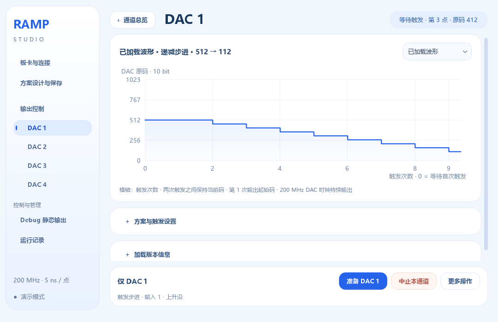

# 触发步进扫描使用说明

入口：**方案设计与保存 → 触发步进**。本模块用于外部触发逐点改变 DAC 原码。计数和加法由 FPGA 在 200 MHz 时钟域执行，上位机负责配置、保存和状态显示。

## 逐次输出规则

设起始码为 S、步长为 Δ、扫描点数为 N，第 n 次有效触发输出：

`DAC(n) = S + (n − 1) × Δ，n = 1…N`

点数包含起始点。例如起始码 100、步长 50、5 点，输出依次为 **100、150、200、250、300**。第 1 次触发输出 100，不会跳过起始点。两次触发之间一直保持当前原码；保持高电平本身不会反复推进，必须出现新的所选边沿。

| 设置 | 含义 |
|---|---|
| 扫描起始码 | 第 1 次有效触发时输出的原码 |
| 每次步长 | 整数，正数递增、负数递减，0 表示各点输出相同原码 |
| 扫描点数 | 1～65535，包含起始点 |
| 首次触发前 / 取消布防码 | 下载提交或重新布防后、首次触发前的输出；取消布防也返回此码 |
| 中止码 | 中止后输出的原码，中止会清零扫描进度 |
| 方案 DAC 位数 | 10、12 或 14 bit；原码范围分别为 0～1023、0～4095、0～16383 |
| 触发方式 | 外部触发，或通过软件按钮逐次推进 |
| 触发输入 / 有效边沿 | 选择输入编号和上升沿或下降沿 |

软件会检查起点和末点是否都在原码范围内。线性整数扫描的全部中间点因此也有界；越界会阻止保存/下载，不会静默回绕、裁剪或按位数缩放。原码与电压的对应关系由 DAC 硬件决定。

## 到达末点后

- **末点保持并结束**：第 N 次触发输出末点并进入“已完成”，继续触发不会改变输出。再次点击“准备”或“布防”会从首次触发前的等待码开始新一轮。
- **循环扫描**：第 N 次触发输出末点并保持，第 N+1 次触发回到起始码。不会在两次触发之间自动跳回，也不按固定时间播放。

扫描过程中“准备”会复用已加载且已布防的同一配置，不会意外把进度清零。需要中途从头开始时，先“取消布防”或“中止”，再“准备”。取消布防和中止返回的码由各自设置决定。

## 保存、分配与触发

1. 在“触发步进”页新建方案，填写原码、步长、点数、末点行为及触发设置。
2. 检查末点数值和阶梯预览，点击“保存扫描方案”。名称、原码、位数和设置随方案保存；未保存编辑自动保存在 `scan_draft.json`。
3. 进入 DAC 页，展开“方案与触发设置”，选择保存的扫描方案，点击“准备”。程序先校验并下载配置，回读确认后布防。
4. 在指定输入接入触发信号；真实 FPGA 接收边沿后推进，串口无需为每一步发送码值。演示设备可在“更多操作”中模拟所选触发。
5. 选择“软件单步”时，每点击一次 DAC 页的软件触发按钮推进一点。串口往返决定软件操作速度，不适合精密定时。

DAC 页顶部显示当前点序号和原码，展开“加载版本信息”可查看完成轮数。初始点序号为 0，表示尚未接收本轮第一次触发；1 表示已输出起始点。完成轮数在 65535 处饱和显示，不会使扫描停止或计数回绕。

发布目录的“扫描示例”提供两个可导入的 10 bit 方案：`112 → 512`（步长 +50、9 点、末点保持）和 `512 → 112`（步长 −50、9 点、触发循环）。在扫描页“管理方案 → 导入”中选择对应 JSON。

预览横轴是**触发次数**，不是毫秒。蓝色曲线为已确认加载的配置，灰色为本地保存版本。修改本地方案不会改变已加载曲线或正在运行的扫描。曲线是配置预览，当前点和码值以状态回读为准；界面刷新速度不代表 FPGA 的触发处理速度。

## 多路 DAC 和触发接线

同一保存方案可以分配给多路 DAC。沿用相同输入和边沿，并在第一次触发前统一准备，这些通道会在同一个 FPGA 核心时钟接受扫描事件。也可以为每路选择不同方案，或在 DAC 页选择“为本 DAC 单独设置”，使用不同触发输入和边沿。

同一物理输入上的事件会送到所有等待该输入的通道，包括其他波形或扫描。先准备全部相关通道，再发送第一次触发，避免某一路在晚布防后少接收前面的事件。

外部输入经同步器后产生边沿事件，DAC 时钟持续为 200 MHz。边沿到数据输出存在同步与输出寄存器延迟，不能将“200 MHz 核心”直接当作可保证接收任意宽度脉冲。输入高、低电平需要跨过采样时钟；触发脉宽、板级信号质量、DAC 建立/保持时间仍需硬件测量。机械按键抖动会产生多个边沿，应使用干净的触发源或外部消抖。

## 固件升级与掉电恢复

触发步进需要新 FPGA 固件；旧固件不会把扫描当作普通波形播放。新版上位机根据设备能力提示升级，拒绝向不支持扫描的固件下载。升级一次后，日常修改起始码、步长、点数和触发输入只需重新准备方案，不需要重烧固件。

若要掉电保留扫描设置，在“板卡与连接 → Flash 固化与启动”中纳入所需 DAC 的保存方案，重新构建并固化。启动后会恢复配置、从第 1 个扫描点等待触发；**不会恢复断电时已经扫到的点序号**。普通“准备”或“下载”写入 FPGA 易失配置，不能跨断电保存新设置。

开发仓库的 `release/FPGA-XC7A35T-TriggerScan` 提供四路 10 bit 数字验证镜像，标识为 `09133301`。该镜像没有内置实验上电快照，配置后各 DAC 保持 512，须先准备自己的方案。已验证软件、RTL 和 200 MHz 核心时序；本轮没有烧写实板，DAC 外部接口时序尚需确认。镜像规格、校验值与限制见文件夹内“使用与验证说明.md”。

扫描可与 Ramp、自定义函数和执行序列分别分配到不同 DAC。当前模块是每 DAC 独立扫描方案，不是嵌套在执行序列中的步骤，也不会同时占用另一只 DAC。原有历史 FM 字段不会参与本模块。
