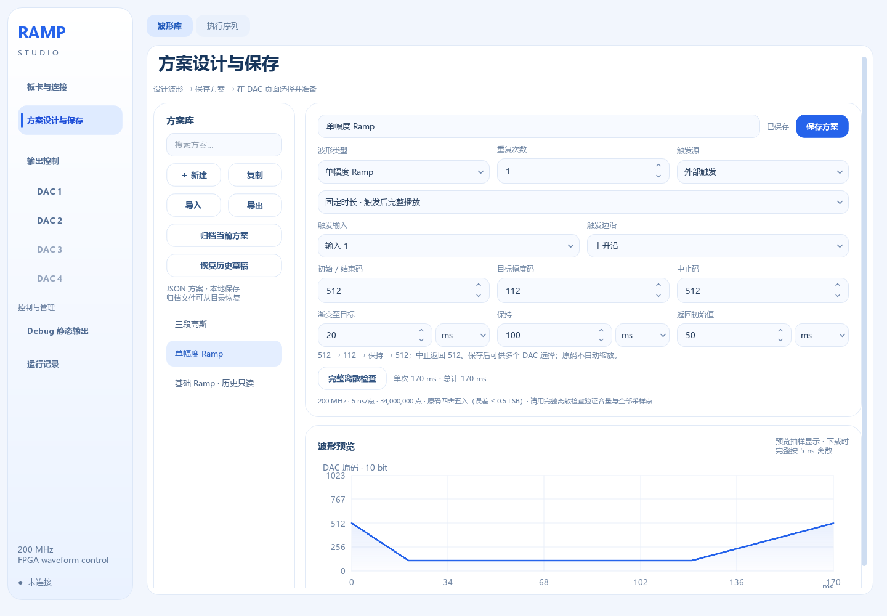
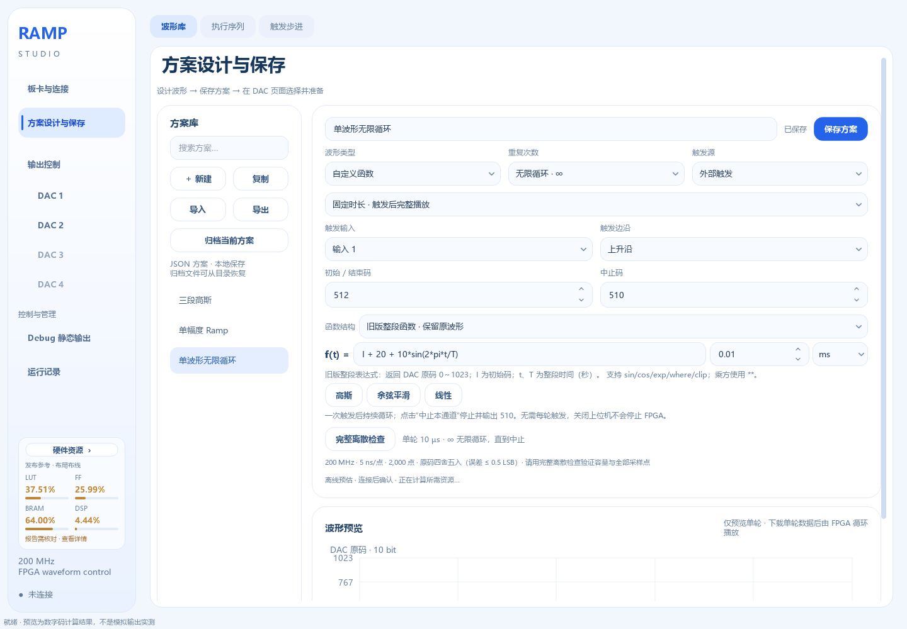
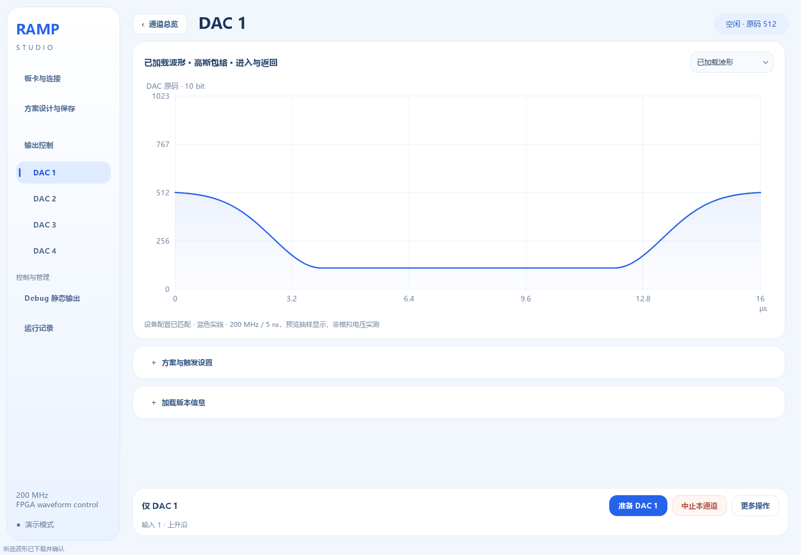
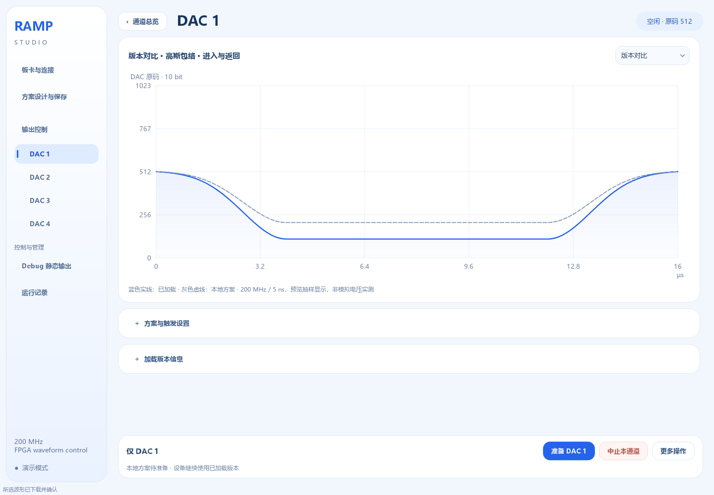
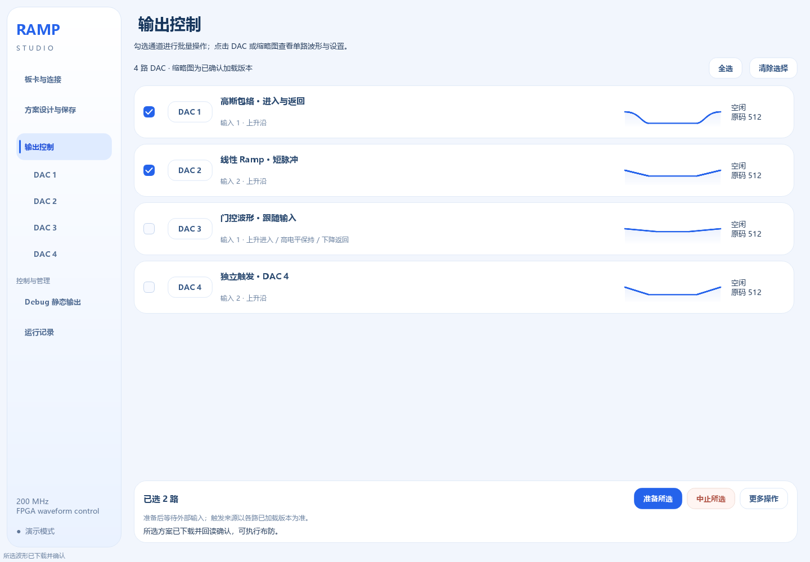
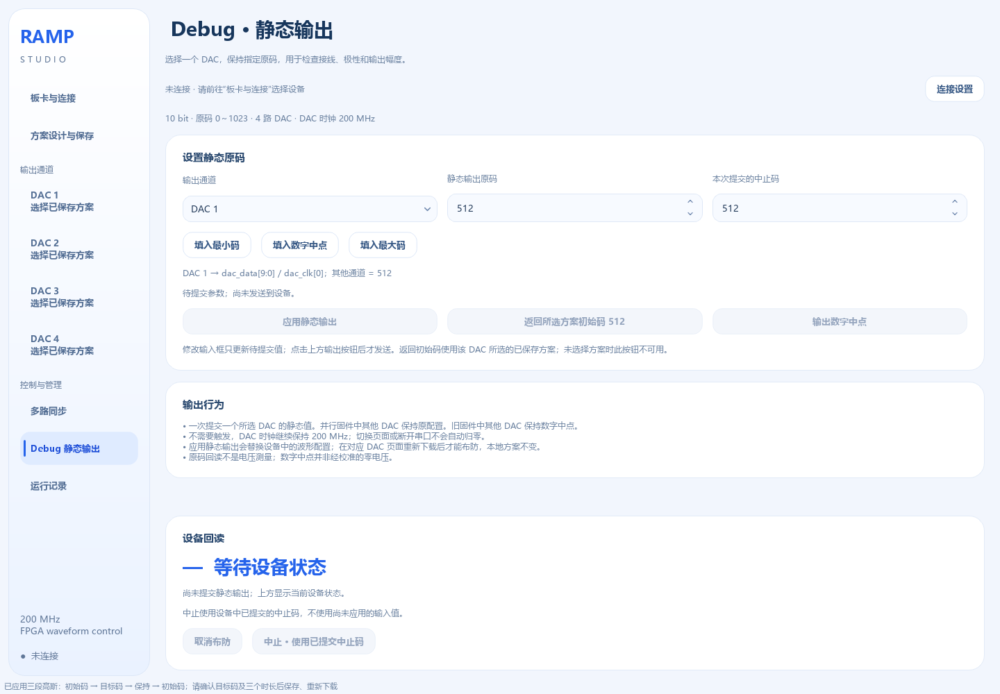
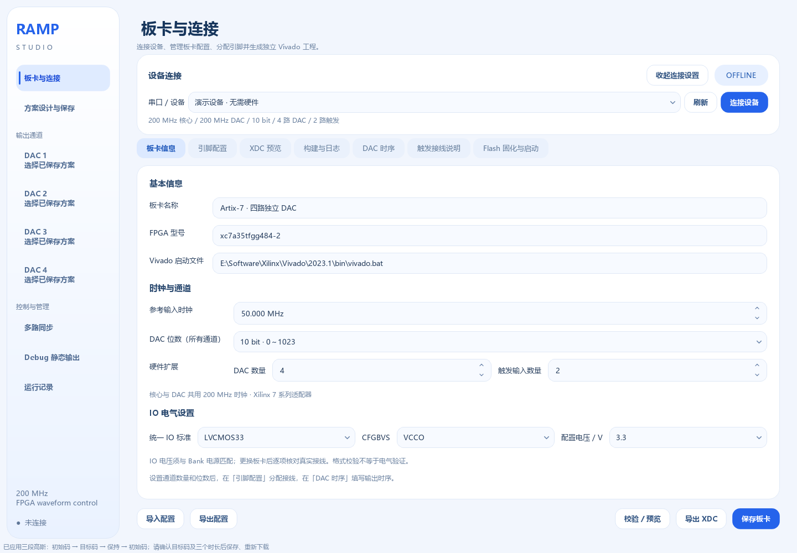
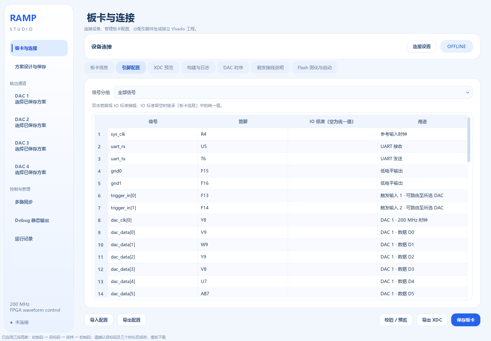
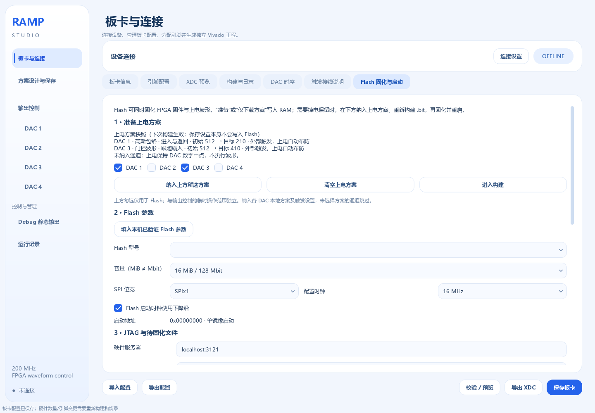

# Ramp Studio 软件详细使用手册

文档版本：2026-09-17 · 高速 USB / UART 双接口版，含分段线性插值、全局工作区保存 / 导入、1M UART 设置、资源能力检查、参考时钟扩展与触发步进扫描。适用对象：实验操作人员、板卡配置人员和维护人员。

本手册以当前软件、独立 RTL 和现存验证记录为依据。文中的截图使用演示配置，截图中的管脚缺项、方案与连接状态不是实板当前状态。更新 EXE 不会自动更新 FPGA 固件。

## 01 从这里开始

**新增输出采样率：**“板卡与连接 → 板卡信息 → 时钟与通道”可选 100 / 125 / 200 MSPS。3PD5651E 选择 10 位、最高 125 MSPS；需要重新构建和烧录，随后按设备回报重新下载波形。USB 仍为独立 60 MHz。旧文中的 200 MHz / 5 ns 描述特指该速率配置，最新行为见 [输出采样率与 3PD5651E](输出采样率与3PD5651E.md)。

**高速 USB 新增入口：**在“板卡与连接 → 板卡信息 → 高速 USB 通信”启用 FT232H，展开“USB 接口参数与达芬奇引脚模板”填写或套用接口引脚。同一份固件保留 UART，软件选择 USB 或串口之一连接。引脚在独立“引脚配置”编辑，XDC 在“XDC 预览”核对；保存设置后须重新构建对应固件，软件不会自动烧写。波形继续存于 BRAM，具体步骤见第 21 节。

**14 位高斯插值新增入口：**在“方案设计与保存 → 波形库”明确选择“方案 DAC 位数：14 bit”“播放编码：分段线性插值”，默认“最大允许差异：1 原码”。输入本实验原码和时间，点击“完整离散检查”，确认“插值段数 / 设备容量”、已检查点数与实际最大差异，再保存、分配到 DAC 并准备。每个保存方案保留自己的位数和精度；改变板卡位数不会自动改写旧方案，下载时二者必须一致。

给定 I=5685、A=0、进入 / 返回各 70 μs、指数系数 5 的高斯，本版得到 139 个插值段，完整检查 28,000 点，最大差异 1 原码。差异比较针对完整原函数取整采样，不表示模拟电压精度。现有参考 BIT `09133301` 不支持新编码，新固件需要另外构建并升级；本任务没有烧写硬件。操作、协议及验证范围见 [14 位高斯分段插值](14位高斯分段插值.md)。

日常使用顺序是：**设计并保存方案 → 为 DAC 选择方案 → 准备（按需下载并布防）→ 触发输出**。需要掉电后脱离电脑使用时，再执行“纳入上电方案 → 构建 → Flash 固化”。

| 你的任务 | 阅读位置 |
|---|---|
| 第一次体验，不接板卡 | 第 04 节：演示模式快速上手 |
| 已有固件，只想修改波形 | 第 05～09 节：设计、分配、下载与触发 |
| 一次触发后持续重复同一波形 | 第 05 节：固定时长波形的无限循环 |
| 检查波形是否超过当前设备容量 | 第 09 节及《资源能力与下发检查》 |
| 14 位高斯超出逐码保持容量 | 《14位高斯分段插值》：显式选择插值编码、设置误差、检查全部采样点 |
| 查看 FPGA 的 LUT / FF / BRAM / DSP 占用 | 第 12 节及《板卡硬件资源占用》 |
| 上升沿开始，高电平保持，下降沿返回 | 第 08 节：电平门控 |
| 单路 DAC 按时间或多个外部事件执行不同波形 | 第 19 节及《执行序列使用说明》 |
| 设置起点、步长、点数，每次触发推进一点 | 第 20 节及《触发步进使用说明》 |
| 检查 DAC 接线与静态原码 | 第 10 节：Debug |
| 增加 DAC、改变位数或更换板卡 | 第 12～13 节：硬件与构建 |
| 高速 USB 下载、串口切换和更换接口引脚 | 第 21 节及《高速USB与串口》 |
| 波形掉电保留 | 第 14 节：Flash 与上电方案 |
| 按钮不可用或没有输出 | 第 17 节：排查表 |
| 备份、迁移或升级软件 | 第 15～16 节及《迁移到其他电脑》复制清单 |

### 当前版本与已烧写版本

| 项目 | 文档整理时的记录 |
|---|---|
| 当前软件 | 左侧提供全局保存 / 导入；支持最高 1M UART 设置、固定时长波形无限循环、资源能力检查、参考时钟配置、触发步进、已加载预览、执行序列及 Flash 功能 |
| 已有 Flash 验证记录的四路固件 | `09112040`；JTAG、UART、Flash 写入校验和从 Flash 重启已通过 |
| 后续临时数字联调镜像 | `79817479`；2026-09-16 经 JTAG 临时加载，四路 10 位 UART 数字检查通过，未写 Flash；详见《已连接板卡数字验证_2026-09-16》 |
| 高速 USB / UART 双接口 | 启用 FT232H 后，同一固件保留 UART；BRAM 容量及播放规则不变，新增接口验证不能沿用旧镜像的资源、时序、实板或吞吐量结论 |
| 新增自动布防及上电波形镜像 | `091121A1`；已构建并通过 RTL 仿真、200 MHz 核心布局布线，尚未烧写实板 |
| 执行序列数字验证镜像 | `091213A1`；131 项测试与 200 MHz 核心检查通过，内含短脉冲测试序列，本轮未烧写实板 |
| 上一版无限重复数字验证镜像 | `091217B1`；153 项检查覆盖并通过，WNS/WHS +0.025/+0.048 ns，支持整表无限重复，未烧写实板 |
| 当前触发步进数字验证镜像 | `09133301`；194 项软件/RTL 检查通过，核心 WNS/WHS +0.006/+0.051 ns；无实验启动快照，DAC 接口时序待确认，本轮未烧写实板 |
| 已完成的人工断电冷启动验证 | 对应旧两路固件 `09111930`，不能用于证明后续四路或上电波形版本 |

完整开发过程见同目录《开发日志》。确认实际板上版本应以设备能力回报、JTAG USR_ACCESS 和自己的烧写记录为准，不能只看 EXE 日期。

## 02 软件、FPGA、DAC 分别负责什么

Python 上位机编辑方案、计算采样点、量化 DAC 原码，并通过当前固件支持的串口或 FT232H 高速 USB 下载。FPGA 保存码段，在硬件触发后按 200 MHz 时钟播放；触发步进则由 FPGA 按配置原生计算每次事件的输出值。DAC 将并行数字码转换成实际电压。电脑不需要每隔 5 ns 或每次外部触发时发送一个点。

| 对象 | 内容 | 保存/操作的作用 |
|---|---|---|
| 设计草稿 | 正在编辑的参数与函数 | 切换页面可继续编辑，正常退出自动保留；不代表已保存到方案库或已下载 |
| 本地保存方案 | 可命名、复制、导入导出的 JSON | 供多个 DAC 选择使用 |
| FPGA 活动配置 | 已通过 COMMIT 提交的 RAM 码段或扫描寄存器参数 | FPGA 独立运行；普通下载不写 Flash |
| 上电方案快照 | 明确纳入板卡配置的各路保存版本 | 用于下次构建，不会自动追踪后续编辑 |
| FPGA 比特流 `.bit` | 硬件逻辑及可选 RAM 初始化数据 | 由 Vivado 从独立 RTL 生成；`.v` 本身不直接烧录 |
| 配置 Flash | 上电加载的比特流 | 写入带上电方案的镜像后，完整启动可恢复这些波形 |

**“保存方案”“下载波形”“固化 Flash”是三个不同动作。** 修改普通实验波形通常只需保存和重新下载；只有永久修改上电内容或修改硬件配置时，才需要重新构建并固化。

## 03 启动、连接与页面导航

### 启动要求

推荐使用 Windows 10/11 x64，将便携包解压到可写目录，双击 `Ramp Studio.exe`。运行库和蓝白图标已内置，无需另装 Python、Qt、NumPy。首次启动可能需要几秒钟解包。

演示模式不需要板卡或 Vivado。真实串口控制需要对应 USB-UART 驱动，FT232H 高速 USB 需要 Windows x64 FTDI D2XX 驱动；固件构建和 JTAG/Flash 操作还需要 Vivado、对应器件支持和 JTAG 连接。

本机 Vivado 可执行文件：`E:\Software\Xilinx\Vivado\2023.1\bin\vivado.bat`。换电脑后填写新电脑的真实路径。

### 退出自动保存与下次恢复

正常关闭软件时，会自动保存当前设置与编辑进度，无需逐页点击保存。下次启动恢复以下内容：

| 内容 | 恢复范围 |
|---|---|
| 板卡与 Flash | 板卡信息、引脚、时序、Flash 参数及尚未填写完整的输入 |
| 三个设计子页 | 波形、执行序列、触发步进的当前草稿，包含未通过校验的参数；时间数值及所选单位一起保留 |
| DAC 与 Debug | 各通道本地方案分配、触发设置、操作勾选，以及 Debug 的所选通道、待提交码和中止码 |
| 界面 | 窗口位置与大小、上次页面和子页、折叠状态、首选串口 |

这些内容保存在实际数据目录的 `desktop_session.json`。通过校验的板卡设置同时写入 `board.json`；板卡输入不完整或无效时保留为会话草稿，不覆盖已有有效板卡文件。重新打开后可继续修正。

**自动保留草稿不会更新方案库中的保存版本。** 希望 DAC 使用本次修改时，仍须点击“保存方案”“保存执行序列”或“保存扫描方案”，然后到目标 DAC 页面准备。恢复 Debug 数字只恢复输入框；恢复首选串口只帮助再次选择。软件启动保持未连接，不自动连接、下载、布防或发送静态输出。

退出时会提交尚未移开焦点的数值编辑，再保存设置。如果写入失败，软件显示原因并保留窗口，修复目录写入问题后重新关闭。构建、Flash 或设备操作尚未结束时仍需等待完成。自动保存发生在正常退出时，不能代替定期备份，也不等同于把波形写入 FPGA 的 Flash。

### 左侧导航

| 页面 | 主要用途 |
|---|---|
| 板卡与连接 | 全局串口连接，硬件参数、XDC、构建和 Flash |
| 方案设计与保存 | “波形库”维护单波形；“执行序列”编排时间和事件；“触发步进”设计逐次触发扫描 |
| 输出控制 | 总览已加载波形缩略图，勾选通道进行批量准备、触发和中止 |
| DAC 1～DAC 4 | 当前通道的大波形图、版本对比、方案与触发设置、单路操作 |
| Debug 静态输出 | 向某一路提交恒定原码，核对数字回报 |
| 运行记录 | 刷新日志、打开实际数据目录 |

左侧 FPGA 信息下方的“全局保存 / 全局导入”管理整套电脑端工作区。与设计页导入 / 导出单个方案、板卡页导入 / 导出单份板卡 JSON 的范围不同，操作步骤见第 15 节。

通道按钮是否可用取决于板卡/设备能力。连接实板后，以 FPGA 回报的 DAC 数量与位数为准；编辑板卡设置不会改变当前设备。

“板卡与连接”还显示固件回报的每路码段容量及事件步骤容量，可点击“刷新能力”重新读取。未连接时显示按板卡配置预估，演示连接显示模拟能力；这两种状态都不代表已检测真实 FPGA。准备或下载前会再次核对连接设备，详见第 09 节。

窗口较小时，左侧通道按钮自动使用紧凑样式；将鼠标放在通道上可查看详细状态。连接、设计、输出和调试各有独立入口，切换页面本身不会发送输出命令。

### 连接真实串口

1. 打开“板卡与连接”，接入 USB-UART 后点击“刷新”。
2. 选择真实 COM 端口，例如本机曾验证的 `COM3 · USB-SERIAL CH340`，选择“波特率”再点击“连接设备”；自动识别固件支持全部预设档位，旧固件选择原固定速率。端口号可能随电脑或插口变化。
3. 核对在线状态及设备回报：当前 3PD5651E 的 125 MSPS 四路配置应为 125 MHz 核心、125 MHz DAC、10 bit、4 路 DAC、2 路触发，默认每路 2048 码段；支持的事件步骤数以已烧录固件实际回报为准。
4. 打开对应 DAC 页等待状态回读。已有匹配上电方案时，不要为了确认连接再次下载。

串口格式为 8N1，默认 115200 baud。可选 9600、19200、38400、57600、115200、230400、460800、921600、1,000,000（1M）。连接期间不能更改速率，先断开后再选择；所选速率在正常退出时自动保存。JTAG 用于配置 FPGA，UART 用于下载波形及控制，两条连接不能互相替代。不要让两个应用同时占用同一个串口。

### 同一份固件切换波特率

新版固件支持 9600、19200、38400、57600、115200、230400、460800、921600、1,000,000（1M）自动识别，格式仍是 8N1。旧固定波特率固件先升级一次；已经支持自动识别的固件，以后切换速率不用重新烧录。

1. 等待当前通信操作结束，点击断开连接。
2. 在连接设置选择需要的波特率，例如 1,000,000。
3. 重新连接。软件发送 BREAK 和同步字节，FPGA 识别速率、锁定收发分频，再回复 INFO。设备摘要显示“波特率自动适配”。

| 设置位置 | 作用 | 生效方式 |
|---|---|---|
| 板卡与连接 → 连接设置 → 波特率 | 本次 UART 连接使用的速率 | 断开、选择、重连，自动适配固件无需重烧 |
| 板卡与连接 → 板卡信息 → UART 上电默认波特率 | FPGA 复位后、尚未训练时的初始速率 | 改变默认值需要构建固件，但正常切换连接速率不必改它 |

旧固件没有自动识别能力，仍必须选择它固定使用的波特率；只替换 EXE 不会给旧 FPGA 增加功能。首次升级后，如需掉电继续使用自动识别版本，再将该版本固化到 Flash；已有上电方案必须按需包含在新的固件快照中。波特率每次连接重新识别，无需为每一档分别固化。

1M 是 1,000,000 baud，8N1 每字节占 10 个线路位，单向线速上限约 100,000 字节/秒；协议、应答及调度使实际下载速度更低。USB-UART 芯片、驱动和线路也须支持所选速率。串口训练仅清空串口半包，不中止或重新布防 DAC；输出按已下载的波形继续。USB FIFO 使用独立接口，无波特率选项。详细协议、异常恢复和验证范围见 [UART 自动波特率](UART自动波特率.md)。

当前 R2 已在 CH340 上验证九档切换，四路 125 MSPS 波形在重连期间继续运行，1M 下每路 2048 段下载约 0.60 秒。固件文件夹为 `release/FPGA-XC7A35T-AutoBaud-20260917-R2`，标识 `09171830`。本轮只临时 JTAG 加载，未写 Flash，掉电后恢复原 Flash 版本；见 [UART 实板验证](UART实板验证_2026-09-17.md)。

## 04 演示模式快速上手

1. 在“板卡与连接”选择“演示设备 · 无需硬件”，点击连接。若要体验四路，先在未连接时把板卡 DAC 数量设为 4，再连接演示设备。
2. 打开“方案设计与保存”，新建或复制一个单幅度 Ramp。命名为“演示 Ramp”，设置初始码 512、目标码 508、中止码 512，进入 70 ms、保持 100 ms、返回 70 ms。
3. 时间控制选择“固定时长”，重复次数 1，触发源选择外部触发、输入 1、上升沿。
4. 等待自动资源检查，确认没有函数/容量错误；也可点击“完整离散检查”重新检查，然后保存方案。此时显示的是演示设备容量。
5. 打开 DAC 1，展开“方案与触发设置”，在“本地方案”选择“演示 Ramp”，点击“准备 DAC 1”。确认后显示已加载波形，设备进入等待触发。
6. 在“更多操作”中点击“模拟所选触发”。新版演示器完成后回到初始码并等待下一次触发，再点击一次可看到完成次数累加。
7. 在“更多操作”中点击“取消布防”结束等待。需要修改方案时，回到设计页编辑并保存，再在 DAC 页点击“准备”。

演示设备没有真实 DAC 输出；其时间推进由电脑系统时间模拟。完整 5 ns 逐拍行为由 RTL 仿真与硬件时序检查验证，不能通过演示动画测量。

## 05 方案设计与保存



### 参数含义

| 参数 | 含义与使用方法 |
|---|---|
| 波形类型 | 新实验使用“单幅度 Ramp”或“自定义函数”；历史分段为只读记录，不再提供 FM 扫描 |
| 初始 / 结束码 I | 下载提交后、等待触发时及正常完成后的输出码 |
| 目标幅度码 A | 唯一目标原码，不是“相对初始码增加多少”，也不是电压单位 |
| 中止码 | 点击中止后输出的原码；允许与初始码不同。使用已下载版本的值 |
| 渐变至目标 | 进入段持续时间 |
| 保持 | 固定时长模式的平台时间；门控模式由外部高电平决定 |
| 返回初始值 | 从目标返回初始码的时间 |
| 重复次数 | 固定时长模式可选“指定次数”（1～65535 轮）或“无限循环 · ∞”；后者一次触发后持续重复，直到中止 |
| 触发源 / 输入 / 边沿 | 指定软件触发，或某一路外部输入的所选边沿 |

本机原 10 位 DAC 的关系为：码 0 电压最大，512 接近零，1023 电压最小且为负。因此码值下降可能对应电压上升。软件只处理原码，不进行电压标定或极性翻转；不要把数字 0 当作零电压。

### 固定时长波形的无限循环

1. 在“波形库”选择单幅度 Ramp 或自定义函数，时间控制使用“固定时长”。三段函数和兼容的旧整段函数均可使用。
2. 在“重复次数”中选择“无限循环 · ∞”。需要有限播放时改回“指定次数”，填写 1～65535 次；无需在数字框手动输入 0。
3. 设置一轮波形、触发源及中止码，保存方案。到目标 DAC 页面选择此方案，再点击“准备 DAC n”。
4. 准备并布防后，使用一次软件触发或所选外部边沿开始播放。FPGA 持续重复完整波形，每轮不再等待新触发；运行中的额外触发不会从头重启当前波形。
5. 点击该 DAC 的“中止本通道”停止，输出已加载版本的中止码。断开串口或关闭软件不会停止仍供电的 FPGA。



预览和完整离散检查只需一轮，反复播放复用同一份存储；无限循环不会无限扩展采样表，也不能解决单轮容量超限。总时长显示为无限，完成轮数在 65535 饱和后仍继续运行。

未连接时可以编辑和保存无限方案。准备或下载时，软件重新读取设备的无限重复能力；旧固件不支持时会在写入波形前提示不兼容。已经回报支持该能力的固件无需因本次界面更新重新烧写，是否支持以当前连接设备回报为准。

电平门控按“上升沿进入—高电平保持—下降沿返回”工作，返回后自动重新布防，因此不显示固定重复次数和无限循环选项。触发步进的“末点保持 / 循环”仍按每次触发推进一点，操作见第 20 节。多个波形组成整张时间表后循环，使用第 19 节的“整表重复”。

### 方案库操作

“＋ 新建”建立新的编辑方案；“复制”适合保留旧实验参数后修改。搜索框按名称筛选方案。“导出”用于分享单个方案 JSON，“导入”用于载入保存文件。“归档当前方案”将本地文件移入 archive，之后可以重新导入；它不会停止 FPGA 上正在执行的波形。

窄窗口使用顶部“波形方案”选择器；点击“管理方案”展开搜索、复制、导入导出及归档操作，编辑区域不会被长方案库占据。输入框按可用宽度排列，软件触发时隐藏外部输入/边沿，门控时隐藏固定重复次数和无关触发设置。

草稿与保存版本相互独立。改变设计页数值不会立即改变输出；点击“保存方案”也不会自动下载。DAC 页始终选择保存版本。一个方案可分配给多路 DAC；共享该方案的各路在保存更新后，都需要各自确认并下载新版本。

### 历史方案与旧版草稿

方案库中的旧分段方案会标注“历史只读”，保留原参数表和波形预览，可以查看、导出或归档。历史预览采用原更新间隔，不表示当前 DAC 正在输出该波形。普通 Ramp、自定义函数与执行序列的参数校验不再受旧 FM 元数据影响。

如果历史方案恰好是“从初始码渐变至目标—保持同一目标—返回初始码”的三段结构，可以点击“转换为 Ramp 副本”。该操作生成独立、未保存的新方案，保留初始码、目标码、中止码、三个时长、重复次数和触发源；外部输入按输入 1、上升沿初始化。采样改为 200 MHz / 5 ns，因此不能当作与原来的低速台阶逐点相同。检查原码、时长、触发设置和预览后，再保存并到 DAC 页准备。不会自动覆盖原方案或下载到设备。

不满足上述结构的多段历史方案，保留只读记录，请在“执行序列”中按所需步骤重新编排。原始 JSON 继续兼容读取，程序启动时不会自动重开旧编辑器。

存在旧版草稿时，方案库显示“恢复历史草稿”：当前 Ramp/函数草稿恢复为新的编辑副本，历史分段草稿以只读方式打开，再按需转换。未保存的原码、分段时长与名称修改也会恢复。在新的设计草稿写入前，旧 `designer_draft.json` 的完整内容会备份至 `user_data/archive/legacy_designer_draft_<校验值>.json`；恢复入口可读取这些备份。旧 `dac_editors.json` 原文件保留。

### 时间单位与实际采样

每个时间输入可独立选择 ns / µs / ms / s。切换单位保持填写的数值不变，例如 `70 ms → 70 µs → 70 ns`，实际时长按新单位计算，需要保存并重新下载。若改为 `70 s` 超出单波形时长范围，会保留数字并提示修正，不自动缩小。编辑数值后按 Enter 或移开焦点确认。恢复草稿和加载旧方案保持已保存的实际时长；函数中的 `t` 和 `T` 始终使用秒。

硬件采样周期为 5 ns。三段自定义函数各段分别量化为整数个周期；单幅度 Ramp 在 5 ns 时间网格上计算。边界非整数周期时以完整离散结果为准。固定时长的单轮波形总时长最多 1 秒，指定多次播放可让一次触发的总执行时间超过 1 秒；无限循环持续到中止。

“完整离散检查”遍历全部采样点。预览只显示约 1600 个抽样位置，三段函数还会补充边界点，预览正常不等于全部点都已通过检查。对复杂或长函数，检查与下载可能需要等待；不能以缩小预览窗口提高实际硬件容量。

编辑波形后，后台会重新检查完整采样与资源需求。等待或检查中表示结果尚未确认，旧的通过结果不能沿用到新参数。界面同时标明能力来自实板回报、演示设备还是离线板卡预估；最终下发仍按当前连接设备复核。

## 06 三段自定义函数

选择“自定义函数 → 三段函数 · 进入 / 保持 / 返回”。输入初始码 I、目标码 A 及三个时长，进入和返回公式可分别编辑；中间保持段自动输出 A。

| 符号 | 含义 |
|---|---|
| `I`、`A` | 初始码与目标码 |
| `t` | 当前阶段局部时间，从 0 开始，单位秒 |
| `T` | 当前阶段量化后的时长，单位秒 |
| `pi`、`e` | 数学常数 |

进入段必须满足 `f(0)=I`、`f(T)=A`；返回段满足 `f(0)=A`、`f(T)=I`。每段实际采样到 `T−5 ns`，由下一段或完成后的初始码接续终点。

### 半高斯示例

设置 I=512、A=112，进入 1 ms、保持 2 ms、返回 1 ms，点击“高斯”。软件使用端点归一化的半高斯，先由 I 到 A，保持 A，再由 A 返回 I。

```text
进入：I + (A-I)*(exp(-4.5*(1-t/T)**2)-exp(-4.5))/(1-exp(-4.5))
返回：I + (A-I)*(exp(-4.5*(t/T)**2)-exp(-4.5))/(1-exp(-4.5))
```

### 其他可直接使用的表达式

```text
线性进入：I + (A-I)*t/T
线性返回：A + (I-A)*t/T

余弦进入：I + (A-I)*(1-cos(pi*t/T))/2
余弦返回：I + (A-I)*(1+cos(pi*t/T))/2
```

支持 `sin`、`cos`、`tan`、`exp`、`sqrt`、`log`、`abs`、`minimum`、`maximum`、`min`、`max`、`where`、`clip`。`min/max` 是两个参数的逐点运算。乘方写 `**`；指数仅支持 0～16 的常量。分段条件使用 `where(条件, 真值, 假值)`，不支持 Python 语句、导入模块、属性访问或下标访问。

例如 `where(t<T/2, I, A)` 可以构造两级函数，但仍须满足所选三段结构的端点要求。`where` 的两个分支都可能被数组计算求值，不要依赖条件隐藏除零或无定义运算。

函数直接返回 DAC 原码。负值、超出位数上限、NaN、无穷大会被拒绝；需要限幅应明确写 `clip(表达式,0,1023)`，其他位数改用相应上限。限幅不能免除阶段端点检查。

函数值按 `floor(x+0.5)` 四舍五入，正常量化误差不超过 0.5 LSB。默认逐码保持将相邻相同原码无损压缩为一个连续码段。显式选择分段线性插值时，会额外产生相对于原取整采样的近似差异；完整检查必须确认每一点均满足所设原码误差上限，两种误差不能混为一项。

旧文件中的整段函数保留原来的时间定义，例如 `512-400*sin(2*pi*t/T)` 是整个区间的函数，不会自动改成三段高斯。可以选择新模板切换为三段，再确认参数和保存。

## 07 DAC 单路下载与固定时长触发



### 单路操作

1. 点击左侧 DAC 或总览中的通道名/缩略图，进入该通道的大波形页面。右上显示实时回读状态与原码。
2. 展开“方案与触发设置”，选择本地保存方案；需要不同接线时，选择“为本 DAC 单独设置”，填写触发方式、物理输入和边沿。同一个波形可用于不同 DAC，不会因此改写共享方案。门控固定为外部输入、上升进入/下降返回；事件序列保留逐步输入设置，点击“编辑方案”修改每一步。
3. 核对本地方案的容量结果，再点击底部“准备 DAC n”。程序先刷新设备能力，完整检查参数与容量，再按设备配置 ID 比较已确认版本；只下载需要更新的波形，回读确认后布防。已加载且匹配的波形直接复用，已经布防且匹配时不重复发送 ARM。
4. 正在等待旧版本触发或运行时，先“中止本通道”，或通过“更多操作 → 取消布防”退出等待，再准备修改后的版本。
5. 外部触发使用实际输入边沿；软件触发点击“软件触发”。“更多操作”保留“仅下载方案”“仅布防”“取消布防”及演示输入；仅下载不会自动布防。模拟输入会影响等待同一输入的所有演示通道。

底部标明“仅 DAC n”，准备、软件触发和中止仅作用于当前通道，与总览勾选无关。“更多操作 → 中止全部通道”是明确的全局操作。

### 已加载、本地方案和版本对比

默认显示“已加载波形”：使用与设备回读的有效配置 ID 对应的本地快照，蓝色实线显示计算后的 DAC 原码。修改或归档本地方案不会替换已加载曲线。尚无匹配快照时显示待确认提示，不把当前编辑内容当作设备波形。

切换为“本地方案”可查看下次准备的保存版本（灰色虚线）；“版本对比”叠加两者。未保存的设计草稿不参与输出。预览抽样显示，实际下载仍按 200 MHz、5 ns 完整离散取整；图形是数字码计算结果，不能代替模拟电压实测。门控与事件序列用事件顺序示意，等待/高电平保持没有固定时间刻度；不同时间轴类型不直接叠加。

设计页、DAC 通道页、执行序列和触发步进的波形图默认按当前显示的波形自动缩放纵轴，纵轴仍为 DAC 原码，使用整数刻度。范围包含图中实际绘制的初始、结束及等待码，并为曲线留出边距；常值或仅变化 1 个码值时也有可读的显示范围。上下界受所选 10 / 12 / 14 位 DAC 合法原码范围约束。设计页的原始函数虚线与取整曲线共用纵轴；“版本对比”中的已加载与本地曲线也共用同一纵轴，便于核对差异。

输出总览中的各通道缩略图分别自动缩放，鼠标停留时可查看该图显示的原码范围。因此不能只按不同缩略图的曲线高度比较 DAC 幅度，应查看范围或进入通道大图读取刻度。

自动缩放只改变图形显示，不改变方案原码、时间参数、取整与下发数据，也无需更新 FPGA 固件。范围依据当前抽样预览中的点计算，不能据此认为全部 200 MHz 采样点已通过检查；门控高电平保持段仍为示意，实际时长由外部输入决定。



“加载版本信息”默认收起，可展开查看两份方案名称、配置 ID、当前原码和完成次数。修改参数后只保存到电脑，设备继续使用原来的已加载配置，直到成功准备新版本。

### 固定时长的完成行为

| 条件 | 完成后行为 |
|---|---|
| 指定次数，新固件支持自动布防，方案为外部触发 | 执行 repeat 轮，返回初始码，预取后自动等待下一边沿 |
| 指定次数，软件触发 | 执行 repeat 轮后进入“已完成”；再次运行先 ARM，再软件触发 |
| 无限循环，软件或外部触发 | 一次触发后持续重复，不进入完成或等待状态；点击“中止本通道”停止并输出中止码 |
| 旧固件不支持自动布防 | 完成后需要手动 ARM，无需重传相同波形 |

固定时长一旦触发，就按已保存时长完整播放；外部电平随后降低不会自动开始返回。若需下降沿控制返回，使用下一节的电平门控。

自动布防的预取需要数个 5 ns 周期；运行中及尚未就绪时的新边沿不排队。完成次数是累计波形轮数，在 65535 饱和，内部仍继续执行；每次触发内的 repeat 计数单独管理。手动布防、取消或中止会重置相应计数。取消布防/中止后，不会被自动布防逻辑重新启动。

### 硬件触发接线

本机输入 1 为 F13，输入 2 为 F14。信号源接所选输入管脚，并与板卡共地；UART RX/TX 不是外部触发脚。输入必须匹配 Bank 电源和 IO 标准，不可仅按“管脚上是 0/1”忽略实际电压。

布防前已经存在的高电平或低电平不算新边沿。代码经过输入同步和固定输出寄存器，触发由 FPGA 处理，不依赖 Python 轮询，但不是零延迟。现有接线说明建议高、低各至少 20 ns；可靠最短脉宽、触发间隔及模拟输出延迟仍需板上测量。不要用串口状态时间戳测量纳秒级延迟。

## 08 上升沿开始、高电平保持、下降沿返回

1. 在设计页选择 Ramp 或三段自定义函数，时间控制改为“电平门控”。
2. 设置初始码、目标码、进入和返回时长，选择外部输入。保持时长隐藏，重复次数和边沿选择不参与控制。
3. 保存，在目标 DAC 页下载并布防。
4. 同一根输入线的上升沿启动进入段；进入完成后保持目标码，直到下降沿到来。
5. 下降沿启动返回段，完成后回初始码并自动重新布防。

例如进入 70 ms、返回 70 ms，外部高电平 500 ms：忽略输入与输出管线延迟，前 70 ms 进入，约 430 ms 保持，下降沿后用 70 ms 返回。实际保持时间无需预先输入，也不占用额外采样表。

**提前下降沿有不同处理。** 若尚未到达目标，FPGA 捕获当前原码 C，从 C 线性返回 I，而非跳到目标或强行播放原半高斯返回。10/12/14 位的整数步长准备分别需要 55/65/75 ns（从同步后的边沿事件计），期间保持 C；之后每 5 ns 更新，使用设定返回时长精确回到 I。

进入、保持和返回期间的新上升沿不重启；返回期间的下降沿不改变当前返回。返回后仍需预取，现有门控说明建议为下一上升沿预留至少 50 ns，且前一返回必须已结束。过早边沿不排队。

进入和返回各至少一个周期，合计最多 1 秒；高电平保持无固定超时。点击中止会停止门控自动布防，并输出已下载的中止码。

## 09 输出控制总览与多路操作



四路共享 200 MHz 时钟，各自拥有独立波形存储、参数和状态。左侧“输出控制”统一显示已加载名称、触发摘要、缩略图、当前状态与原码；本地存在修改时标记“待准备”。点击 DAC 名称或缩略图进入单路大图，两种视图不会堆叠。

1. 先在各 DAC 页选择本地方案及触发设置，再返回总览勾选本次要操作的通道。勾选只决定操作范围，不开关输出。
2. 核对各路容量状态，点击“准备所选”。程序刷新设备能力并完整检查全部所选方案，任何一路超限或不兼容时都不写入本次新波形。全部通过后，逐路下载需更新的版本并回读确认，最后向需要布防的通道发送一次分组 ARM；未变化的配置不重复下载。已布防的匹配通道保留等待状态。
3. 软件触发：所选通道全部为匹配且已布防的软件触发方案时，点击“软件触发”，FPGA 发出分组启动信号。混合外部/软件触发的选择不会启用软件触发按钮，应分别操作对应通道组。
4. 外部同步：各路设置同一物理输入和边沿，准备完成后由同一外部信号启动；也可为不同组设置不同输入。门控共用同一输入的上升/下降沿。输入可逐通道设置，事件序列则按每一步的输入执行。
5. “中止所选”仅停止勾选通道；“更多操作 → 中止全部通道”操作所有实际通道。进入单路后，操作范围切换为当前 DAC；返回总览保留原有勾选。

若后续通道下载失败，已成功提交的通道仍可能更新。界面保留逐路确认结果，并回读状态；准备流程失败时不会继续发送最终分组布防。已布防通道原有的外部输入仍可能触发，因此准备期间的回读状态应一起核对。数据下载不是跨通道原子事务。

串口状态逐路轮询，不能用页面更新时间测量 5 ns 级同步误差。旧单播放器固件只允许单路准备；四路演示和独立多路操作需设备回报支持并行通道。

### 存储容量

以下为本版 BRAM 配置，USB 和 UART 使用相同容量。活动与待提交两个 bank 的容量不能相加；连接后以实际固件回报为准。

| 同一固件 DAC 数量 | 默认每路连续码段上限 |
|---|---:|
| 1 | 8192 |
| 2 | 4096 |
| 3～4 | 2048 |
| 5～8 | 1024 |

以设备 INFO 实际回报为准。码段数量不是采样点数量：一个恒定码保持 100 ms，虽然持续 2000 万个周期，仍可以只占一段。快速振荡函数可能在很短时长内超限。编译器不自动降采样、缩放或截断波形；“完整离散检查”通过后，下载还会检查设备的每路容量。

### 自动资源检查与超限提示

设计页检查正在编辑的波形，DAC 页与总览检查各路分配的本地保存方案。例如 `1,402 / 2,048 码段` 表示需求和上限；超过上限会显示超限数量并阻止准备。修改、切换方案或设备能力变化后，旧结果失效，等待后台重新检查。资源状态不代表修改已经加载到 FPGA。

事件/门控序列需要同时满足波形池容量和设备回报的步骤容量，当前固件为每路最多 64 步；同一通道内相同波形数据可由多个步骤复用。触发步进检查功能支持、原码和 1～65535 点协议边界，只写配置参数，不逐点占用采样表。

每路存储在固件构建时已分配，不能借用其他 DAC 的空闲槽位。活动与待提交两个 bank 用来保护完整配置切换，不能相加为单波形容量；四路原 BRAM 固件默认每路 2048 码段。仅在上位机减少参与通道，不会改变已烧录固件的容量。

UART 能力信息不包括具体 FPGA 型号、LUT、FF 或物理 BRAM 总量；协议里的平台 ID 只是固件类别。物理资源须查看对应固件的 Vivado 构建报告，不能由波形码段用量推算。当前资源检查可用于已有支持 GET_INFO 的固件，不需要为显示能力重新烧写；各波形模块仍须由固件提供相应功能。

完整说明、能力来源及调整方法见[资源能力与下发检查](资源能力与下发检查.md)。

## 10 Debug 静态 DAC 输出



静态输出统一在 Debug 设置。DAC 页的状态显示在右上，中止等控制固定在下方；Debug 页的设备回读与中止固定在下方，滚动预览或参数时仍可操作。Debug 切换通道后，回读与提交确认按通道区分。

1. 连接设备，在 Debug 选择 DAC，确认该通道未运行且未布防。
2. 输入“静态输出原码”和“本次提交的中止码”。
3. 点击“应用静态输出”，检查回读通道、配置 ID 和原码是否一致。
4. 需要核对实际电压时使用测量仪器；软件无 ADC，不会自动测量电压。

| 按钮 | 是否发送 | 行为 |
|---|---|---|
| 填入最小码 / 数字中点 / 最大码 | 否 | 只修改输入框 |
| 应用静态输出 | 是 | 提交恒定配置，不需要触发 |
| 返回方案初始码 | 是 | 使用该 DAC 所选保存方案的初始码；未分配方案时禁用 |
| 输出数字中点 | 是 | 提交 512 / 2048 / 8192，对应当前位数 |
| 中止 · 使用已提交中止码 | 是 | 使用设备当前配置的中止码，未应用的输入值无效 |

静态配置会替换该路 RAM 波形，DAC 时钟继续输出。切换页面、退出软件或断开串口不会自动归零；返回波形工作时需要重新下载并布防。当前 Debug 不直接提供“把静态配置写入 Flash”的功能。

## 11 状态、版本确认和按钮不可用

| 状态 | 含义 | 通常允许的下一步 |
|---|---|---|
| 空闲 | 未布防；可能已有有效配置 | 下载、静态输出；有效且匹配时可布防 |
| 等待触发 | 已 ARM；可能短暂处于预取阶段 | 触发、取消布防、中止 |
| 运行中 | 正在进入、保持、返回或重复播放 | 等待结束或中止；不能覆盖配置 |
| 已完成 | 软件触发或旧固件单次任务完成 | 再次布防，或下载新方案 |

DAC 页“所选保存版本已下载并确认”说明已确认快照的方案指纹与当前设备配置 ID 匹配。“设备正在使用与所选方案一致的上电固化版本”说明设备上报了上电来源标记，且 ID 与所选保存版本匹配；无需重新下载。

真实串口的确认快照保存在本机 `loaded_waveforms.json`。重连同一串口后，仅在通道、DAC 位数、有效状态与配置 ID 一致时复用快照；演示设备每次连接重新确认。没有匹配快照时显示未知配置，不能从 FPGA 反读完整波形。这个缓存用于显示和版本识别，不是掉电保存功能；换电脑时应连同 `user_data` 迁移。不要仅因提示未确认就在实验过程中重配置 FPGA。

## 12 板卡、XDC、位数和扩展

“板卡与连接”下有七个标签页：板卡信息、引脚配置、XDC 预览、构建与日志、DAC 时序、触发接线说明、Flash 固化与启动。

左侧栏底部常驻显示 LUT、FF、BRAM、DSP 的占用百分比，切换页面时仍可查看。点击“硬件资源”打开完整报告窗口，查看已用 / 总量与来源，执行“刷新构建报告”或“导入报告”；完成本机构建后自动更新。“报告来源与关联”默认折叠，可展开核对时间、设计、工具版本和 SHA256。报告配置变更后会提示旧配置；发布固件参考和导入报告不会被当作串口实测。详细操作及迁移目录见[板卡硬件资源占用](板卡硬件资源占用.md)。

“板卡信息”集中设置名称、FPGA 型号、Vivado 路径、时钟、UART 上电默认波特率、位数、通道数量及统一 IO 电气参数。“引脚配置”只保留信号筛选和引脚表，表格随窗口伸展，支持按 DAC、触发输入、参考时钟或通信筛选。双击管脚或普通 IO 标准编辑；普通 IO 留空时继承板卡统一值。参考时钟 IO 标准在“板卡信息”单独设置，引脚表中只显示结果。

“高速 USB 通信”提供可选 FT232H 设置；启用后，引脚筛选出现“高速 USB FIFO · 15 根”。USB 使用独立 IO 标准和输入输出延迟，UART 原有管脚继续保留。XDC 预览包含实际 USB 管脚及 60 MHz 时钟约束；详细换板流程见第 21 节。

参考输入支持单端 sys_clk 或差分 sys_clk_p / sys_clk_n，提供 50 / 100 / 200 MHz 快捷按钮。差分输入使用同一对专用时钟 P/N 管脚，可配置 LVDS_25/LVDS 和内部终端；核心及所有 DAC 均保持 200 MHz。修改参考频率或输入形式后必须重新生成并烧写固件，原 50 MHz 单端板无需为新增界面选项重烧。详见 [参考时钟配置](参考时钟配置.md)。

UART 上电默认波特率随板卡 JSON 的 uart_baud 字段保存，旧配置未填写时默认 115200。该参数适用于单端、差分以及包含上电波形的生成固件。新版还支持连接时自动识别全部九档速率，因此正常使用不需要修改上电默认值。电脑端连接速率独立保存；旧固定波特率固件的兼容步骤见第 03 节。

底部的保存、导入、导出及 XDC 操作始终可见。切换标签页会保留当前填写内容；“保存板卡”将板卡信息、引脚、时序及 Flash 设置一起保存到同一份板卡配置。正常退出也会保存有效配置；未通过校验的输入保留在会话草稿中，已有有效板卡文件不受影响。已有 JSON 无需迁移。

进入引脚、时序、XDC 或 Flash 等子页后，顶部连接设置默认收起，以留出编辑空间；点击“连接设置”可随时展开。XDC 缺项列表和触发接线说明可独立滚动，避免长说明挤占编辑区。





### 位数和 DAC 数量

| 位数 | 原码范围 | 数字中点 |
|---|---|---:|
| 10 | 0～1023 | 512 |
| 12 | 0～4095 | 2048 |
| 14 | 0～16383 | 8192 |

同一固件统一位数，不支持在一个当前工程中混用 10 位和 14 位 DAC。改变位数不会自动按比例换算已有原码；超范围需自行修改。连接实板后，设备回报的位数具有优先权。

增加 DAC：修改数量，为新增时钟和每个数据位分配真实管脚，补齐时序，重新生成、实现并烧写。仅在界面把 4 改成 8 不会增加硬件资源。新增触发输入也需要真实 IO 及新固件。

位数变化时，软件按“第几路 DAC 的第几位”迁移已知引脚。新增高位留空，不猜测接线。更换芯片或接线后应逐项核对，不能只依赖迁移结果。

### 本机四路 10 位管脚表

器件 `xc7a35tfgg484-2`，参考时钟 50 MHz。以下来自已整理的四路配置及原 XDC 对照，不是任意 FPGA 的通用管脚。

| 数据位 | DAC1 | DAC2 | DAC3 | DAC4 |
|---|---|---|---|---|
| D0 | V9 | U18 | N22 | N19 |
| D1 | W9 | U17 | M22 | N18 |
| D2 | Y9 | V19 | M21 | M20 |
| D3 | V8 | T18 | L21 | N20 |
| D4 | U7 | V20 | K22 | J21 |
| D5 | AB7 | R18 | K21 | J20 |
| D6 | V7 | N17 | J22 | G20 |
| D7 | AB6 | P17 | H22 | H20 |
| D8 | AB8 | R16 | G22 | L18 |
| D9 | AA8 | P15 | G21 | M18 |
| 时钟 | Y8 | R14 | E19 | F21 |

| 信号 | 本机管脚 |
|---|---|
| sys_clk | R4 |
| FPGA UART RX / TX | U5 / T6 |
| trigger_in[0] / [1] | F13 / F14 |
| gnd0 / gnd1 | F15 / F16，逻辑低电平输出；不能替代板上电源地 |

通道与端口关系：DAC1 为 `dac_data[9:0]`，DAC2 为 `[19:10]`，DAC3 为 `[29:20]`，DAC4 为 `[39:30]`；对应时钟 `dac_clk[0]`～`[3]`。一般位数 B 下，第 n 路（从 0 数）使用 `dac_data[n*B +: B]`。

本板参考 IO 为 LVCMOS33。CFGBVS、CONFIG_VOLTAGE、各 Bank 电源和外接信号电压仍需按实际板卡确认。导入“参考模板”时 UART 可能留空；随包四路板卡模板包含本机已知映射，两者不要混淆。

### DAC 时序

“DAC 时序”页上方设置默认 `set_output_delay -min/-max` 及采样边沿，下方可逐路覆盖。留空继承默认，且最小延迟不得大于最大延迟。窗口较小时，可滚动查看全部时序设置。

数值必须依据 DAC 建立/保持要求和板级走线关系确定。现有 DAC 型号及完整接口时序未知，不应随意填 0 ns 来让构建通过。核心达到 200 MHz 不等于 DAC 模拟端或外部接收接口完成验收。

跨 FPGA：通用播放 RTL 与平台适配器分开，但 GUI 构建当前支持 Xilinx 7 系列；其他厂商、UltraScale 等仍需平台与工具适配，不能使用同一 `.bit`。

## 13 Vivado 构建与比特流

1. 保存/导入正确板卡配置，填写 Vivado 路径。
2. 校验 XDC。草稿允许缺项，完整实现要求全部管脚和 DAC 时序有效。
3. 在“构建与日志”选择模式并启动，等待明确完成或失败消息。

| 模式 | 输出与用途 |
|---|---|
| 生成工程与时钟 IP | 创建独立工程、200 MHz Clocking Wizard IP；不证明时序收敛 |
| 生成并综合 | 综合检查、时钟与资源报告；不生成最终可烧录镜像 |
| 核心布局布线检查 | 允许约束草稿，检查内部路径并保存报告/DCP；不自动生成 `.bit` |
| 实现与 bitstream | 要求完整约束，通过实现、建立和保持时序后生成 `.bit` |

每次构建创建独立目录，通常为 `user_data/builds/studio_时间/`。便携 EXE 将 RTL/Tcl 展开到同级 `studio_时间_sources/`，避免工程依赖临时解包目录。含上电方案时还生成 `studio_时间_boot/`，保留清单、RAM 文件和顶层。

完整实现成功后，`.bit` 自动填入 Flash 页；该动作尚未烧写。新工程只使用独立 `rtl/`，不引用 `Assistant_FPGA/` 的源码或旧 IP。`.xdc` 是约束、`.v` 是源码、`.bit` 是配置镜像，不能互相代替。

建立/保持失败时应查看报告并修复逻辑或约束，不能只看最后一次“路由完成”。本项目历史数字联调镜像是保留外部 DAC 未签核边界的专用交付，并不表示 GUI 的完整实现可以跳过缺失约束。

## 14 Flash 固化与掉电保存



### 配置 Flash 参数

| 字段 | 填写规则 |
|---|---|
| Flash 型号 | Vivado 完整配置存储器名称；扫描型号库并不是识别实物芯片 |
| 容量 | MiB 与 Mbit 区分；128 Mbit = 16 MiB |
| SPI 位宽 | SPIx1 / SPIx2 / SPIx4，匹配接线与比特流启动设置 |
| 配置时钟 / 下降沿 | 仅影响 Flash 启动加载，不是 200 MHz DAC 时钟 |
| 硬件服务器 | 本机通常为 localhost:3121 |
| JTAG 目标 / FPGA 器件 | 扫描后明确选择；多板时不得默认选错设备 |
| 固化来源 | 使用 `.bit` 生成并固化，或直接使用已有 `.mcs/.bin` |
| 待固化比特流 | 选择本器件、本引脚及预期上电方案对应的 `.bit` |
| 已有 Flash 镜像 | 选择地址 0 的连续 SPI 单镜像 MCS/BIN，BIN 偏移固定为 0 |
| 预期 USR_ACCESS | 可选 8 位十六进制版本标识；留空仅检查 DONE/CRC |
| 固化前备份 | 默认开启，读取并保留整片 Flash 备份 |

本板历史实读 JEDEC 为 `20 BA 18`，验证使用 `mt25ql128-spi-x1_x2_x4`、16 MiB、SPIx1、16 MHz、下降沿。JTAG 目标曾为 `localhost:3121/xilinx_tcf/Digilent/210512180081`，器件 `xc7a35t_0`。换板重新扫描核对，不要把此表当作其他板卡的默认硬件事实。

### 使用以前生成的 MCS / BIN

在“固化来源”选择“使用已有 MCS / BIN · 直接固化”，选择实际镜像文件后，先点击“检查镜像 · 不连接硬件”。此步骤无需安装 Vivado；检查格式、容量、配置包和 FPGA IDCODE，不连接设备。已有镜像不需要原 `.bit` 或再次综合、布局布线。

随后核对 Flash 型号、容量和 SPI 位宽，断开软件的 USB/UART 连接，扫描选择 JTAG，再点“备份并固化 + 校验”。软件重新检查输入快照并匹配 JTAG 器件 IDCODE，默认先备份后写入，执行 Vivado Verify 和完整镜像逐字节读回比较；成功后点“从 Flash 重启”。硬件操作仍需要 Vivado 和 JTAG。

此模式隐藏上电方案编辑，禁用配置时钟与下降沿选项；这些内容由已有镜像决定。IDCODE 匹配不等于引脚、封装、DAC 配置及实验方案匹配。仅支持地址 0 的连续镜像，拒绝地址空洞、重叠和无法解析的文件，不提供 MultiBoot 或加密镜像的配置与验证。具体规则与操作见 [Flash 固化与启动](Flash固化与启动.md)。

### 把各 DAC 波形永久保存

1. 保存实验方案，在各 DAC 页选择保存版本。
2. 在 Flash 页“准备上电方案”中单独勾选希望纳入的 DAC，与输出总览的勾选独立。未分配方案或在本页取消勾选的通道不纳入。
3. Flash 页点击“纳入上方所选方案”，逐路检查快照名称、初始/目标码及触发方式。该操作保存板卡 JSON，不改动硬件。
4. 进入构建并选择“实现与 bitstream”。工作进程完整离散、取整、检查每路容量，生成包含 RAM 初始化数据的固件。
5. 核对 Flash 页的 `.bit`。仅生成 MCS/BIN 是镜像格式转换，不会把新编辑的波形附加到旧 `.bit`。
6. 断开上位机串口后，扫描/选择 JTAG，执行“备份并固化 + 校验”。确保输出可中断，并等待写入完成后再断电。
7. 成功后点击“从 Flash 重启”。烧写完成时 FPGA 可能仍处于辅助配置，不能省略重启步骤。
8. 完整断电再上电验证时，先只读检查 DONE/CRC/版本及串口状态，不重新下载 `.bit` 或波形，以免掩盖启动问题。

固化前会检查 FPGA 型号与 Flash 容量/位宽。默认备份成功后再按镜像地址范围擦写，并进行 Vivado 校验和 BIN 逐字节读回比较。错误日志不能当成成功；关闭备份开关后软件不会提供本次原内容备份。

带上电方案的镜像在完整启动时初始化 RAM，外部触发方案自动 ARM，无电脑也可运行。软件触发方案等待软件命令，不会开机自动播放。未纳入通道保持数字中点。配置阶段及锁定/复位过程不是一个保证无瞬态的模拟输出过程。

**“准备”中的下载和“仅下载方案”仍只写 RAM。永久修改波形必须再次纳入、构建和固化；当前没有 UART 直接将任意运行波形写入 Flash 数据区的功能。** 这套实现复用比特流中的 RAM 初始化数据，不新增用户 SPI 管脚。

“清空上电方案”只清除下次构建的快照。要让板卡下次启动不再恢复旧波形，还需构建不含快照的镜像并重新固化。

### 断连、复位、掉电的区别

| 动作 | FPGA 波形的后续行为 |
|---|---|
| 切换页面、关闭 EXE、断开 UART | 不自动停止硬件；RAM 波形通常继续保留 |
| 普通 UART 下载并提交 | 临时替换所选 DAC；不修改 Flash |
| 中止 / 取消布防 | 停止执行或等待，不等于删除本地方案或擦除 Flash |
| 时钟失锁/逻辑复位，未完整重配置 | 当前实现使活动配置失效，避免被改写 RAM 与旧启动参数错配；需重新下载或从 Flash 重配置 |
| 临时 JTAG 下载 `.bit` | 运行所选镜像；未固化时掉电会丢失此次临时配置 |
| 完整从 Flash 启动 | 恢复 Flash 中固件，以及该镜像明确包含的上电波形 |

备份、输入 `.bit/.mcs/.bin` 快照、镜像检查摘要、读回和日志在 `user_data/flash_jobs/时间戳/`。整片原始 `.bin` 备份使用“已有 MCS / BIN”模式，不当作 `.bit` 再转换；仅接受地址 0 含可识别匹配启动配置且容量合适的备份，写入会覆盖其完整范围。两种来源的路径分别自动保存；全局导出保存路径文本，镜像文件需另行复制。

## 15 日志、数据与备份

“运行记录 → 打开数据目录”是查找实际路径的可靠入口。便携版通常为 EXE 旁的 `user_data`；首次运行目录不可写时可能使用 `%LOCALAPPDATA%\RampStudio\user_data`。已有数据不可写会报错，高级部署也可设置 `RAMP_STUDIO_DATA_DIR`。

### 全局保存：将工作区导出为一个文件

入口位于**左侧 FPGA 信息下方 → 全局保存**。

1. 完成当前输入，点击“全局保存”，选择保存位置和文件名，例如 `实验A.ramp-workspace`。
2. 软件先提交输入框内尚未移开焦点的编辑，并保存当前会话，再导出工作区文件。未完成或无效参数保留为草稿，已有有效板卡配置继续保留。
3. 保存完成后，将该文件放到备份位置，或与软件便携包一起传到新电脑。

`.ramp-workspace` 是单文件 ZIP 工作区包，日常使用不需要手动解压。

| 包含内容 | 保存含义 |
|---|---|
| 方案库 | 所有已保存的波形、执行序列与触发步进方案 |
| 编辑进度 | 三个设计子页的当前草稿、时间数值与单位，包括未完成输入 |
| 板卡设置 | FPGA 型号、引脚、参考时钟、DAC 配置与时序、UART 上电默认波特率、Flash 参数及上电方案快照 |
| 通道与调试 | DAC 方案分配、触发覆盖、操作勾选、Debug 待提交原码 |
| 界面会话 | 首选串口、电脑连接波特率、页面、折叠状态和窗口设置 |

**全局保存保留编辑进度，不会把草稿自动发布为方案库中的保存版本。** DAC 仍使用已保存并已准备的版本。想让本次编辑用于输出，仍按“保存方案 → 准备 DAC → 触发”的顺序操作。

### 全局导入：恢复整套工作区

1. 断开软件中的设备连接，等待构建、Flash 与其他后台操作完成。
2. 点击左侧“全局导入”，选择 `.ramp-workspace` 文件。
3. 核对显示的包摘要，确认要替换当前电脑端方案与设置。全局导入按整套工作区替换，不将两套方案库合并；只想加入一个波形时使用设计页的单方案导入。
4. 导入前，软件自动将当前工作区备份到实际数据目录的 `archive/workspaces/`。导入成功后自动重新打开工作区，保持未连接。
5. 核对方案、通道分配及板卡设置。在新电脑上重新选择 COM 端口、Vivado 和需要使用的外部文件路径，再主动连接设备。

需要恢复导入前的工作区时，通过“全局导入”选择 `user_data/archive/workspaces/` 中相应备份包。备份位置属于实际数据目录；EXE 日常使用时通常是 `release/user_data/archive/workspaces/`。

全局导入不会发送下载、布防、触发或 Debug 静态输出，也不会改写板卡中的 RAM 波形或 Flash。Debug 恢复值只是待提交输入；上电方案恢复的是下次构建所用的配置快照。工作区导入与 FPGA 掉电保存是独立操作。

导入文件不作为设备已下载确认。本机已有的设备确认缓存、历史归档、资源报告及报告选择保留原文件；资源报告按导入后的板卡设置重新检查匹配关系，板卡配置不同会显示不一致提示。当前设备状态仍须在主动连接后确认。

### 工作区包与完整目录备份的区别

工作区包不包含 EXE、Vivado 安装、生成的 BIT / MCS / BIN、硬件 Flash 内容、运行日志、Flash 作业记录、构建缓存、历史 `archive/`、资源报告及报告选择，也不含 `loaded_waveforms.json` 设备确认缓存。Vivado、BIT、备份镜像等外部路径只保存文本，引用的文件不会跟随路径自动打包；迁移后须重新选择实际文件。导入不会覆盖或删除接收端上述已有历史资料。

需要带走日志、旧构建或 Flash 备份证据时，正常关闭程序后复制整个 `user_data`，并另外保留数据目录之外的固件与备份文件。只导出单个方案 JSON 的范围更小，不包含板卡设置和其他 DAC 分配。

### 数据目录中的文件

| 位置 | 内容 |
|---|---|
| profiles/ | 已保存方案 JSON |
| desktop_session.json | 退出自动保存的完整会话：设置、未完成草稿、时间单位、DAC 分配、Debug 待提交值及界面位置 |
| designer_draft.json | 尚在编辑的设计草稿 |
| sequence_draft.json、scan_draft.json | 执行序列与触发步进的独立草稿 |
| parallel.json | 各通道方案分配、触发覆盖与输出操作勾选 |
| loaded_waveforms.json | 真实串口已确认加载快照，重连时按配置 ID 匹配 |
| flash_selection.json | 独立的 Flash 纳入通道选择 |
| board.json | 器件、时钟、引脚、时序、Flash 与上电方案快照 |
| resource_report_selection.json、resource_reports/ | 当前报告选择与手动导入报告副本；相对数据目录保存路径 |
| desktop.ini | 便携版保留的窗口与时间单位等界面设置；迁移时与完整会话文件一起保留 |
| archive/ | 已归档方案；其中 workspaces/ 保存全局导入前的自动备份包 |
| logs/YYYY-MM-DD.jsonl | 带时区时间的事件、配置、命令结果和错误 |
| builds/、build_时间.json/log | Vivado 工程、构建配置及日志；新构建含 resource_report.json 关联资源报告，具体日志形式随启动方式而异 |
| flash_jobs/ | 各次 Flash 操作的独立证据目录 |
| startup-error.log | 启动错误诊断，若能写入 |

完整目录备份时关闭程序，复制整个 `user_data`，并保留对应 `.bit`、Flash 整片备份及版本校验记录。运行日志不是模拟采集数据。

## 16 迁移、软件升级与诊断

将 EXE 和整个 `user_data` 一起复制到新电脑的可写目录。新电脑安装必要的 USB-UART 驱动，重新选择 COM 端口及波特率；旧固定波特率固件须匹配原值；电脑连接速率和板卡固件速率设置都会随数据迁移。只有需要构建/烧写时才配置 Vivado 与 JTAG。旧快捷方式路径可能失效，重新创建即可。

使用高速 USB 时，还需在新电脑安装 Windows x64 FTDI D2XX 驱动，并连接开发板独立的 USB SLAVE 接口；CH340 串口驱动不能替代它。USB 启用状态、IO 参数和管脚随完整 `user_data` 或全局工作区包迁移。已烧录的双接口固件可选 USB 或 UART，切换前先断开当前连接。详见《迁移到其他电脑》第七节。

只迁移方案和设置时，也可在旧电脑“全局保存”，在新电脑解压最新版便携 ZIP、启动 EXE 后“全局导入”。这种方式无需手动放置 `user_data`；导入会替换接收端工作区并先自动备份。准确目录及步骤见《迁移到其他电脑》。

升级 EXE 前先保存并关闭旧窗口。更新软件文件不会自动升级板上逻辑；若要使用新的自动布防或上电波形，需要相应固件。旧固件能否使用某功能由能力回报决定。

便携诊断命令示例：

```powershell
& '.\Ramp Studio.exe' --self-test 'E:\RampChecks\report.json'
```

普通自检使用演示设备，在报告旁创建隔离数据目录，不连接实板。诊断报告可证明启动与模拟流程，不能代替 Flash 冷启动或 DAC 测量。

## 17 常见问题排查

| 现象 | 优先检查及处理 |
|---|---|
| 找不到 COM | 检查数据线、USB-UART 驱动与设备管理器，再刷新；JTAG 连接不一定提供串口 |
| 找不到 USB FIFO 设备 | 使用独立 USB SLAVE 插口，安装 x64 FTDI D2XX 驱动后刷新；USB UART 和 JTAG 是不同接口 |
| 找到 FT232H 但无应答 | 核对烧录的是否为支持 USB 的双接口固件、FT232H 是否配置为 245 FIFO 模式、设备是否被占用；软件不自动修改 EEPROM |
| 切换 USB / UART 后状态不符 | 先断开另一入口并重新连接，读取设备能力及实际状态；不要由两个程序同时控制同一板卡 |
| 导入测试配置提示 DDR3 不受支持 | DDR3 测试路径已撤销，使用本版 BRAM 配置重新生成工程；不要把外存测试容量当作当前容量 |
| 无法连接/端口被占用 | 关闭其他串口应用；确认只有一个控制程序占用端口 |
| 能选端口但连接超时 | 核对 U5/T6 接线、板卡供电、正确固件和双方 UART 速率，格式为 8N1；随包参考固件用 115200，不能只把电脑切到 1M |
| JTAG 烧录后 1M 正常，断电后连接失败 | 检查 Flash 是否仍是旧速率固件；先按实际启动版本连接，再将需要的新版固件固化 |
| 提高波特率后下载失败 | 断开并以较低速率重连，检查适配器、驱动、接线与共地；旧固定波特率固件须选择其原值或先升级 |
| 下载按钮灰色 | 通道是否已布防/运行？先取消或中止；是否选择保存方案、能力和位数是否匹配？ |
| 布防按钮灰色 | 是否下载确认？是否修改过保存版本或刚重连？上电来源与 ID 是否匹配？ |
| 布防后没输出 | 外部/软件源是否选对？是否产生布防后的新边沿？输入号、管脚、电平和共地是否正确？ |
| 高电平已存在但不启动 | 需要布防后的新上升沿，不是电平为高就启动 |
| 下降沿不开始返回 | 是否仍为固定时长？改用电平门控并重新保存、下载 |
| 固定时长只响应第一次 | 核对自动布防能力；旧固件完成后手动 ARM，或升级固件 |
| 提前下降后不是半高斯 | 提前返回按当前原码线性返回，是当前设计行为 |
| 函数预览正常，检查失败 | 检查未被预览抽到的越界/无定义采样点，以及实际每路码段容量 |
| 波形超过 2048 段 | 四路容量限制；降低函数变化复杂度/频率、缩短适用波形或重新设计硬件容量，软件不会自动降采样 |
| 离线检查通过，连接后超限 | 离线为板卡配置预估；以实际固件回报为准，检查位数、通道数和每路容量 |
| 容量状态显示检查中 | 等待完整离散结束；修改参数后的旧结果已失效，预览图不能代替完整检查 |
| 数值越界或位宽不一致 | 检查实际设备位数和方案原码，10→14 不自动按电压比例缩放 |
| 中止没有使用新填写的值 | 设备使用最后提交的中止码；编辑后尚未下载/应用时无效 |
| Debug 后原波形不能直接布防 | 静态提交替换了 RAM 配置，重新下载对应波形 |
| 固化按钮灰色 | 先断开串口，等待构建或其他 Flash 操作结束；核对选择的 JTAG 与 `.bit` |
| 只有 XPR，没有 `.bit` | 当前模式可能只是生成/综合/核心检查；完整约束和实现通过后才产生 `.bit` |
| 断电后波形不见了 | 普通下载不持久；核对是否纳入、构建、真正固化了带上电数据的新镜像及启动模式 |
| 已纳入新方案，上电仍是旧波形 | 快照只影响下次构建；检查是否实际选择并固化了新 `.bit`，是否完成从 Flash 重启 |
| Flash 校验失败 | 保留日志与备份，检查型号、容量、链路、供电和所选镜像；不要报告为成功 |
| 码 0 输出很大正电压 | 符合用户说明的 10 位 DAC 极性；使用原码并测量，不能把 0 当零电压 |
| 新电脑看不到历史方案 | 是否复制整个 user_data？是否实际使用了回退路径或环境变量指定路径？ |
| 退出提示设置未保存，窗口没有关闭 | 检查数据目录写入权限、磁盘空间和文件占用，处理后重新关闭；当前编辑仍保留在窗口中 |
| 重启恢复了草稿，DAC 仍是旧方案 | 自动保存保留编辑进度；点击对应“保存方案”后，再为 DAC 准备新版本 |

## 18 操作结束与验证边界

实验结束时，若希望停止输出，先明确选择中止或提交所需静态码，并确认所选通道回报，再断开串口。单纯关闭窗口不会停止 FPGA。串口中止存在传输和处理延迟，不是专用硬件急停。

历史版本依据：蓝白版 27 项相关回归及便携启动检查通过；此前自动布防/上电方案版本 113 项全套测试通过，对应镜像核心时序 WNS +0.008 ns、WHS +0.053 ns。这些记录只对应当时版本；新增插值的数值、逐拍、四路资源与时序范围以 [14 位高斯分段插值](14位高斯分段插值.md) 的验收记录为准。本次没有进行新版实板烧写、受控外部边沿或断电验证，未知 DAC 建立/保持参数、物理时钟波形和模拟电压仍需仪器确认。

详细专题可继续阅读同目录《Flash固化与启动》《三段自定义函数》《电平门控》《四路DAC并行输出》《协议-v1》。历史“验收”与“实板验证”文件对应各自版本，不能套用为所有后续版本已通过。


## 19 单个 DAC 执行多个波形（2026-09-12 新增）

“方案设计与保存”内增加“波形库 / 执行序列”页签。固定时间表按一个共同触发后的时间偏移播放多个波形；事件序列按当前步骤选定的触发输入执行，各步骤可共用同一输入，也可分别使用不同输入。门控步骤在下降沿返回完成后推进。

步骤引用保存快照，使用统一初始/等待码和中止码。同一 DAC 的固定时间区间不能重叠，四路 BRAM 固件的各步骤共同使用本通道 2048 码段；事件模式最多 64 步，共用波形数据池。指定整表次数兼容旧采样播放器，事件模式需要支持 INFO bit5 的新序列固件；硬件验证须看对应新版记录。

**整表无限重复：** 在“执行序列 → 固定时间表”中，将“整表重复”选为“无限重复 · ∞”，保存后在 DAC 页面下载、布防、触发。一次触发后持续循环整个时间表，不再等待每轮触发；点击“中止”停止并输出中止码。步骤内重复次数仍各自生效，预览和存储只需一轮，计数显示到 `65535+` 后仍继续。关闭软件不会停止 FPGA。

这个选项需要支持 INFO bit6 的新版 FPGA 固件，更新 EXE 后还需升级旧板卡固件。方案保存、导入导出与 Flash 上电快照均保留该设置；普通 UART 下载仍不持久化，掉电保留需重新构建并固化包含方案的镜像。事件序列保持“整表结束后回到第一步等待新事件”的行为。

完整操作、示例、输入规则、容量、上电保存及协议见 [执行序列使用说明](执行序列使用说明.md)。


## 20 触发步进扫描

入口：方案设计与保存 → 触发步进。设置起始码、整数步长和点数，每次所选边沿输出一个扫描点，两次触发之间保持当前码。第一次输出起始码，第 n 次输出 `起始码 + (n−1)×步长`。支持负步长、1～65535 点、末点保持或下一次触发从头循环、10/12/14 位、单路与共用输入、多路已加载预览以及 Flash 上电配置。

新模块需要升级一次 FPGA 固件，之后只需下载扫描参数。掉电恢复的是保存的扫描配置，进度从头开始。详细步骤及示例见 [触发步进使用说明](触发步进使用说明.md)。

## 21 高速 USB、串口切换与换板

### 启用 FT232H，同时保留 UART

1. 打开“板卡与连接 → 板卡信息 → 高速 USB 通信”，勾选“增加 FT232H USB FIFO 接口，同时保留 UART 串口”。
2. 展开“USB 接口参数与达芬奇引脚模板”，点击“应用 USB 引脚”。模板补充 15 根 USB 信号，保留 DAC、触发、系统时钟和 UART；管脚冲突会被拒绝。
3. 点击“查看 USB 引脚”，在独立引脚表逐项核对。在“XDC 预览”检查 USB 管脚、60 MHz 时钟、IO 标准以及输入输出 min/max 延迟。
4. 保存板卡配置，在“构建与日志”生成工程并综合，检查资源与时序报告。完整 `.bit` 仍要求完整约束和实现检查通过，生成工程不会自动烧写。
5. 首次使用 USB 需要显式烧录支持双接口的新固件；更新 EXE 或勾选设置不改变板上逻辑。本轮任务不自动烧写 FPGA 或 Flash。
6. 将高速 USB 线接到独立 **USB SLAVE** 插口；串口仍使用 **USB UART**，JTAG 单独用于烧写。

更换板卡时先导出板卡或全局工作区备份，再核对器件型号、参考时钟、电压及管脚。USB 使用独立 IO 标准，不能凭模板断定新板供电或走线一致。界面保存的设置用于重新生成 XDC；只编辑历史构建目录里的 XDC 不会回写界面。其他 FPGA 系列或 USB 芯片可能需要新的适配器。

### 软件选择一个连接入口

| 连接方式 | 设备列表选择 | 前提 |
|---|---|---|
| FT232H 高速 USB | `USB FIFO · 序列号` | 安装 Windows x64 FTDI D2XX 驱动，FT232H 已配置为 245 FIFO 模式，固件启用 USB |
| UART 串口 | 对应 `COM` 端口，并选择波特率 | USB-UART 驱动支持所选速率；新固件自动识别，旧固件须匹配固定值 |

同一份双接口固件可从任一入口控制，软件一次连接一个入口。切换时先断开当前连接，再刷新并选择另一个设备；USB 不使用 UART 波特率选项。切换后重新读取设备能力和状态，不把此前连接的缓存当作本次下载确认。

USB 与 UART 共享同一板卡通道选择、波形池及待提交状态。不要由两个程序同时连接两种接口进行控制，以免相互改变选择或上传内容。软件不会自动安装驱动、改写 FT232H EEPROM，或把专用 Digilent / JTAG 下载器当作高速数据接口。

### 下载与播放保持独立

USB 使用批量码段命令和最多 16 帧的有界传输窗口，逐帧校验序号、CRC 及状态，完成后再 COMMIT。UART 保持逐帧应答，旧固件按能力回报使用原逐段命令。USB 的物理总线速率不等于实测波形下载速度；真实吞吐量需由目标电脑、驱动和硬件测量。

| 项目 | 本版规则 |
|---|---|
| 波形存储 | BRAM；四路每路每 bank 2048 段，双 bank 容量不可相加 |
| 逐码保持最短段 | 1 拍，即 5 ns |
| 分段线性插值最短段 | 32 拍，即 160 ns；每个 5 ns 核心拍输出整数插值结果 |
| 事件序列 | 各步骤共用本通道波形池，相同波形可以复用 |
| 允许误差 | 保留方案设置，完整检查全部采样点，接口切换不修改精度 |
| 掉电保留 | 将方案纳入上电快照，重新构建并显式固化 Flash；普通 USB / UART 下载不写 Flash |

DDR3 扩展已按要求撤销，因此不存在其每段 256 拍（1.28 μs）的下限，也不再提供 MIG 配置。原 14 位高斯插值方案继续使用 BRAM，无需为了高速 USB 改变原码、时长或误差要求。超出本通道容量仍明确拒绝，USB 只改善传输路径，不扩充波形池。

具体接口管脚、协议和验证范围见 [高速 USB 与串口](高速USB与串口.md)。资源、200 MHz 时序及真实板卡结论须以本轮对应构建记录为准，不沿用历史镜像结果；RTL 仿真也不代表模拟 DAC 输出或真实 USB 吞吐量已通过验证。


### 21.5 已连接板卡数字验证与 DAC 诊断默认值

2026-09-17，双接口诊断固件 `09171701` 已临时 JTAG 下载并完成 85 项真实 USB 检查。每路 2048 段下载约 90 ms，测试结束四路为 512、未布防；Flash 未改写，重新上电仍是旧固件。详见 [验证记录](USB实板数字验证_2026-09-17.md)。

“DAC 时序”新增“填入诊断默认值”，填入上升沿、min −0.5 ns、max 1.0 ns，保存后下次继续使用。逐路设置仍优先。这里假设保持时间 0.5 ns、建立时间 1.0 ns，未计入未知走线差；不能保证对其他 DAC / 板卡永久适用。实际采样边沿、外部时序与模拟输出仍需硬件参数或测量确认。


## 软件模拟真实外部触发

请使用 **系统调试 → 触发调试**。先下载自己的外部触发方案并布防，再直接发送脉冲或设置高/低电平。首次发送自动接管输入、恢复原先等待中的通道，不替换已加载波形；切换时会短暂经过中止码并将扫描/序列进度重置。正在播放时不能切换来源。周期脉冲次数 0 表示无限。结束调试或心跳超时会中止全部 DAC 并恢复物理来源；详见 [软件触发调试](软件触发调试.md)。

## 固定低电平控制脚

进入「板卡与连接 → 引脚配置」，在筛选框选择「固定低电平控制脚 · 2 路」。现有端口 `gnd0`、`gnd1` 已由 RTL 固定输出 0（等价于 `assign gnd0 = 1'b0;`），参考模板映射为 F15、F16；这两个名称是历史命名，实际是普通控制 IO，不是电源地。

可编辑封装管脚和 IO 标准，保存板卡配置后查看 XDC 预览的 Constant-low control outputs 分组。程序检查与 DAC、触发、UART、USB 等管脚的重复分配。更换映射后重新生成工程、生成 BIT 并加载，不能只修改 XDC 就改变当前运行固件。未更换映射时，现有固件已经支持这两路低电平。

此固定值在 FPGA 配置完成并进入用户模式后生效；加载前的上电电平不由该 assign 保证。若外设要求配置前也保持低电平，需要硬件下拉。控制脚的 IO 标准须与外设和对应 Bank 电压匹配。
