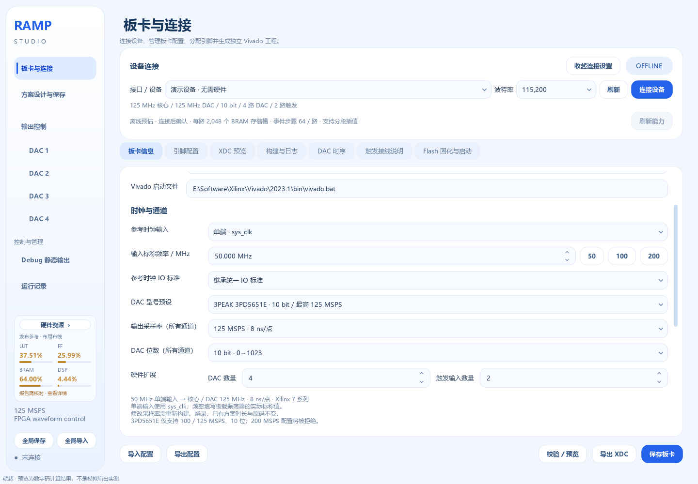

# 输出采样率与 3PD5651E

更新日期：2026-09-17。适用于本次新增的可选采样率版本。

## 1 选择频率

打开 **板卡与连接 → 板卡信息 → 时钟与通道**，设置“DAC 型号预设”和“输出采样率（所有通道）”。

| 输出采样率 | 每点时长 | 70 μs 对应采样点 | 3PD5651E |
|---|---|---|---|
| 100 MSPS | 10 ns | 7,000 | 支持的配置 |
| 125 MSPS | 8 ns | 8,750 | 支持的最高配置 |
| 200 MSPS | 5 ns | 14,000 | 超过芯片上限，预设会拒绝 |

这里设置的是 DAC 的采样时钟，不是高斯脉冲的重复频率，也不是触发频率。四个 DAC 共享所选采样率；本版不支持同一固件内各路选择不同速率或在线无缝切频。

已识别的 3PEAK 3PD5651E 为 10 位、最高 125 MSPS、上升沿锁存。当前模块的 3.3 V 驱动兼容性由使用者确认；本次板卡预设沿用 LVCMOS33。既有实验原码、位数和电压极性不会自动变换。

可直接导入 `boards/davinci_3pd5651e_125msps.json`；便携版对应 `板卡示例/davinci_3pd5651e_125msps.json`。预设为达芬奇 XC7A35T、50 MHz 单端 R4、四路 10 位、两路触发，保留已确认的 DAC / UART / USB 引脚。通用旧板卡文件继续默认 200 MSPS。

## 2 如何生效

1. 选择 3PD5651E、125 MSPS、10 bit，保持实际参考时钟为 50 MHz 单端。
2. 检查“引脚配置”和“DAC 时序”，保存板卡。
3. 在“构建与日志”选择“实现与 bitstream”，等待时序检查和 BIT 生成。
4. 用 JTAG 烧写新 BIT，然后重新连接软件。**只改下拉框或替换 EXE 不会改变板上时钟。**
5. 确认设备信息回报 **125 MHz 核心 / 125 MHz DAC**。本地板卡设置与设备不一致时，界面会显示待生效提示。
6. 重新“准备”或下载所用方案；软件按设备实际频率重新离散，再布防和触发。

如需掉电保存，重新生成包含所需上电方案的固件并进行 Flash 固化。旧 200 MHz BIT 和旧上电存储描述符不能直接当作 125 MHz 固件使用。本次开发验证不自动写 FPGA 或 Flash。

## 3 波形与存储

方案文件保留物理时长和 DAC 原码，不把选定板卡频率写进每个实验。70 μs 仍表示 70 μs；采样时刻和点数随采样率改变，不能把原来 200 MHz 的拍数原样用于低频固件。

逐码保持和分段线性插值均按实际采样点完整检查。误差上限仍是用户设置的原码差异，不会因降频自动放宽。容量仍按每路独立 BRAM 池计算：四路每路 2048 段，活动与待提交 bank 不相加。事件序列中的等待拍数、波形复用、门控返回时间、重复和预览也随实际时钟重新计算。

线性插值最短段仍为 **32 拍**：100 MSPS 对应 320 ns，125 MSPS 对应 256 ns，200 MSPS 对应 160 ns。这是插值描述符的准备范围；段内仍逐拍产生中间码。旧逐码保持允许一拍码段，降频未引入 DDR 存储限制。相邻采样时刻之间的信息不能由离散误差检查保证。

外部门控继续按“上升沿进入 → 高电平保持 → 下降沿返回”执行。提前下降沿、自动重新布防和忙时触发规则保持原有语义；同步、预取和计算等待以时钟拍计，其物理时间会随频率变化。连接界面的串口波特率由新版固件自动识别；旧固件仍须匹配固定速率。USB FIFO 时钟独立保持 60 MHz，见 [UART 自动波特率](UART自动波特率.md)。

## 4 DAC 时序参考

“DAC 时序”中提供独立的 **填入 3PD5651E 典型参考** 按钮：上升沿、最小输出延迟 −1.5 ns、最大输出延迟 2.0 ns，对应芯片手册的典型保持 1.5 ns / 建立 2 ns。逐路覆盖仍优先于默认值。

这些数据位于手册 **Typ** 列，并非保证的极限规格；实际约束还应计入数据与时钟走线差。已确认 3.3 V 可驱动，不等同于完成建立/保持时序实测。125 MHz 的 50% 高电平为 4 ns，100 MHz 为 5 ns；手册高电平宽度参考为 3.5 ns。

来源：[3PEAK 3PD5651E 官方数据手册，BA20251001A1](https://static.3peak.com/res/doc/ds/Datasheet_3PD5651E.pdf)，数字接口及开关特性章节。

## 5 协议和兼容性

复用现有 INFO 的 32 位 `core_hz` 字段；本架构 `dac_divider=1`，因此它同时表示播放采样率。没有新增在线改频命令；CORE_HZ 和 Clocking Wizard 输出来自同一板卡设置。UART 分频器、门控的一秒限制及每路 INFO 都使用这一参数。

新软件读取设备能力后，按 100 / 125 / 200 MSPS 之一编译和检查；未知频率或非预期分频关系会拒绝现代波形下发。旧软件曾固定检查 200 MHz，会拒绝新低频固件，需同步更新 EXE。200 MHz 旧方案继续使用旧默认编译行为。上电方案身份纳入低频时钟，200 MHz 旧身份保持兼容，避免跨频率错误匹配上电数据。

3PD5651E 预设还会在准备、静态输出及布防/软件触发前检查固件频率和位数。连接仅用于读回信息时允许识别旧固件；中止操作始终保留。即使未布防，旧固件也可能持续输出时钟，因此在连接实际 DAC 前应先完成降频固件更新。

## 6 验证记录

软件逐点检查覆盖三个采样率下的 14 位高斯、10 位逐码保持、事件复用、延时、四路下载、静态输出和上电描述符；14 位数值检查用于验证编译器，与当前 10 位芯片配置区分。

125 MSPS 四路 10 位 USB＋UART 配置已完成 Vivado 2023.1 综合、布局布线及 BIT 生成。最终 WNS **+0.135 ns**、WHS **+0.054 ns**，TNS/THS 均为 0；LUT **12,751 / 20,800**，FF **16,108 / 41,600**，BRAM **32 / 50**，DSP **4 / 90**。中途时序告警经既有优化流程收敛，以最终 `timing_routed.rpt` 为准。

构建目录为 `build/sample_rate_20260917/project_125/`；保存了最终时序、IO、资源、CDC、DRC 报告及 BIT。本记录仅代表上述 FPGA、引脚和时序参考值下的静态验证；未进行本次实板烧录或模拟波形测量。其他 FPGA、引脚、DAC 数量、位数和参考时钟组合须重新实现并检查。

100 MSPS 同配置也已完成实现与 BIT 生成：WNS **+0.394 ns**、WHS **+0.049 ns**，TNS/THS 均为 0；LUT **12,756**、FF **16,120**，BRAM **32/50**、DSP **4/90**。证据位于 `build/sample_rate_20260917/project_100/`。

本机便携版的板卡目标设置已保存为 125 MSPS / 3PD5651E；已有实验、Flash 上电方案和逐路时序覆盖保持原值。旧配置及用户设置备份位于 `build/sample_rate_20260917/portable_before.zip`。连接实板后仍以固件实际回报为准。需要手册典型时序参考时，可使用专用按钮或导入随附预设。

### 最终软件验收

按测试文件隔离 Qt 生命周期执行回归，最终 **679 项通过、1 项跳过、0 项失败**。跳过项为 Windows 原生符号链接创建权限不足；同类路径保护与 NTFS junction 测试已执行。新增测试覆盖 100/125 MSPS 下实际 UART 线级帧、独立标称波特率对端、四通道 RTL 的 INFO、门控时限、正负插值和事件切换。

给定 I=5685、A=0、进入/返回各 70 μs 的 14 位高斯：

| 采样率 | 完整检查点数 | 插值段数 | 最大差异 |
|---|---|---|---|
| 100 MSPS | 14,000 | 139 | 1 原码 |
| 125 MSPS | 17,500 | 141 | 1 原码 |
| 200 MSPS | 28,000 | 139 | 1 原码 |

新版 EXE 通过便携迁移与 Windows / offscreen 启动检查，其中包含低频编译及模拟设备下发验证。机器可读结果见 `docs/validation/sample_rates_20260917/validation_summary.json`。完整低频固件发布目录为 `release/FPGA-XC7A35T-3PD5651E-20260917`，其中 `125MSPS/ramp_studio.bit` 和 `100MSPS/ramp_studio.bit` 对应两种采样率。
